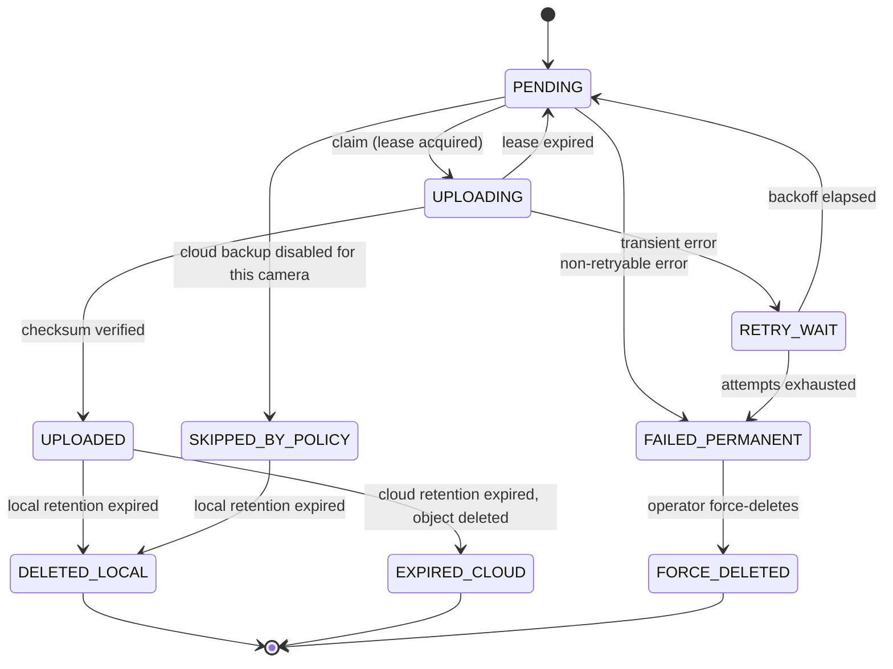

# Contract: database schema

**Parties:** clip-worker, uploader, cleanup, status-collector → `state.db`

One SQLite database at `${DATA_DIR}/data/state/state.db` is the shared state of the
system. It is also the **only** coordination mechanism between our services — they
never call each other. This is what makes any one of them being down a survivable
condition rather than a cascading failure.

> **Implementation note (v0.3.0).** The file currently lives at `${DATA_DIR}/cctv.db`
> (`CCTV_DB`, default `<data_dir>/cctv.db`), which the clip-worker and the uploader both
> name explicitly in `compose.yml` so the two cannot drift apart. Moving it to the
> `data/state/state.db` above is a migration and belongs with the installer (`lld/07`,
> M6). Every accessor is written against `CCTV_DB`, so the move is a configuration change
> plus a file move, not a code change.

---

## 1. Why SQLite

[ADR-0004](../../adr/0004-sqlite-for-state.md). Summary:

| Property | Why it matters here |
|---|---|
| Single file | Backs up with a copy; restores with a copy; no server to lose |
| WAL mode | Concurrent readers with a single writer fits our access pattern exactly |
| Transactional | Atomic state transitions are the core requirement of the uploader |
| Bounded scale | ~100 clips/day × 365 days × several rows = comfortably within SQLite's range for a decade |
| Zero operational surface | No ports, no auth, no version negotiation, no container of its own |

**Explicit non-goal:** multi-host. One database belongs to one site
([ADR-0002](../../adr/0002-independent-per-site-deployments.md)). If multi-host ever
becomes a requirement, that is a new ADR, and Postgres becomes the candidate.

### 1.1 Connection policy

Every service applies, on open:

```sql
PRAGMA journal_mode = WAL;        -- readers never block the writer
PRAGMA synchronous = FULL;        -- durability over throughput; we are low-rate
PRAGMA foreign_keys = ON;
PRAGMA busy_timeout = 5000;       -- wait rather than fail on a brief lock
PRAGMA wal_autocheckpoint = 1000;
```

| Rule | Detail |
|---|---|
| Max writers | **One active writer per table at a time.** Enforced by short transactions, not by coordination |
| Transaction style | `BEGIN IMMEDIATE` for anything that will write, to avoid `SQLITE_BUSY` upgrade deadlocks |
| Transaction duration | Must never span network I/O. Claim → commit → do work → commit |
| Readers | Free to read concurrently; the status-collector reads heavily |
| Checkpoint | Truncate the WAL after a successful backup, not on a timer |

> **Rule:** never hold a write transaction open across an HTTP call to Frigate or an
> upload to B2. Long transactions turn a slow network into a locked database. The
> correct pattern is a short claim transaction that sets a lease, then work outside
> any transaction, then a short completion transaction.

---

## 2. Schema

### 2.1 `schema_migrations`

| Column | Type | Notes |
|---|---|---|
| `version` | INTEGER | PK. Monotonic |
| `applied_at` | REAL | UTC epoch seconds |
| `checksum` | TEXT | SHA-256 of the migration text; mismatch is a hard error |

Applied in ascending order inside a transaction. A downgrade (schema version newer
than the binary) is **refused**, not attempted ([INV-8](../invariants.md)).

### 2.2 `cameras`

Registry of cameras ever seen. History survives configuration changes.

| Column | Type | Notes |
|---|---|---|
| `name` | TEXT | PK. Matches the `cameras.yml` key |
| `display_name` | TEXT | |
| `enabled` | INTEGER | 0/1, from config |
| `first_seen_at` | REAL | |
| `retired_at` | REAL | NULL while active. Set when absent from config ([INV-13](../invariants.md)) |
| `config_hash` | TEXT | Hash of the camera's `cameras.yml` block; a change is logged as an audit event |
| `updated_at` | REAL | |

### 2.3 `clips` — the central table

One row per canonical clip. **A row only exists once the file is durably on disk**,
so a row implies a file (until retention deletes it).

| Column | Type | Notes |
|---|---|---|
| `id` | INTEGER | PK autoincrement |
| `review_id` | TEXT | **UNIQUE.** Frigate's review item id — the idempotency key ([ADR-0016](../../adr/0016-clip-per-review-item.md)) |
| `event_ids` | TEXT | JSON array of the constituent event ids, from the review's `data.detections`. Preserves event-level searchability for a per-visit file |
| `severity` | TEXT | `alert` \| `detection`, from the review |
| `camera` | TEXT | FK → `cameras.name` |
| `label` | TEXT | Primary label, denormalised for querying |
| `zones` | TEXT | JSON array |
| `start_time` | REAL | UTC epoch seconds, from Frigate |
| `end_time` | REAL | UTC epoch seconds |
| `duration_s` | REAL | From `ffprobe`; the achieved duration |
| `requested_start_ts` | REAL | `review.start_time − pre_roll_s`: the range start we asked Frigate for |
| `requested_end_ts` | REAL | `review.end_time + post_roll_s`: the range end we asked for |
| `requested_s` | REAL | `requested_end_ts − requested_start_ts` |
| `coverage_ratio` | REAL | `duration_s / requested_s`. The clip-quality metric ([INV-14](../invariants.md)) |
| `pre_roll_s` / `post_roll_s` | REAL | The values in force when this clip was fetched, so a config change is auditable after the fact |
| `max_gap_s` | REAL | Largest inter-packet delta. Above `max_gap_s`, a hole from a missing recording segment |
| `has_gaps` | INTEGER | 0/1 |
| `has_audio` | INTEGER | 0/1. Distinguishes "the camera has no microphone" from "we dropped the audio" |
| `video_codec` / `audio_codec` | TEXT | e.g. `h264`, `hevc`, `aac`, `pcm_alaw` |
| `fetch_attempts` | INTEGER | Flush retries used for this clip. A rising average means `segment_flush_grace_s` is too short for this host |
| `degraded` | INTEGER | 1 when accepted below `coverage_ok` because retries were exhausted |
| `long_clip` | INTEGER | 1 when the duration exceeded `long_clip_warn_s`. Stored in full regardless |
| `path` | TEXT | Relative to `DATA_DIR`. Never absolute — keeps the DB portable across restores |
| `sidecar_path` | TEXT | |
| `size_bytes` | INTEGER | |
| `sha256` | TEXT | Computed locally before upload |
| `upload_state` | TEXT | See §3 |
| `attempts` | INTEGER | Default 0 |
| `next_attempt_at` | REAL | When a retry becomes eligible |
| `lease_owner` | TEXT | Hostname + pid of the claiming worker |
| `lease_expires_at` | REAL | Expired leases are reclaimable |
| `last_error_class` | TEXT | `transient` \| `auth` \| `not_found` \| `quota` \| `checksum` \| `unknown`. A **closed** set, enforced by `CHECK`. `lld/04` §4's longer list of causes maps onto these six; the retry decision is carried by the error type in code, and the specific cause is in `last_error` and the audit event |
| `last_error` | TEXT | Truncated to 2000 chars. Never contains credentials |
| `cloud_key` | TEXT | Object key, set at claim time |
| `cloud_etag` | TEXT | Provider-reported checksum after upload |
| `cloud_size_bytes` | INTEGER | |
| `uploaded_at` | REAL | |
| `local_deleted_at` | REAL | Set when retention removed the file |
| `cloud_deleted_at` | REAL | |
| `pinned` | INTEGER | 1 while we hold a pin in Frigate |
| `pinned_at` | REAL | Drives the pin reaper |
| `materialised_at` | REAL | When the file was written |
| `created_at` | REAL | |
| `updated_at` | REAL | |

Indexes (each exists for a specific query; no speculative indexes):

| Index | Serves |
|---|---|
| `UNIQUE(review_id)` | Idempotency — the core of [INV-7](../invariants.md) |
| `(upload_state, next_attempt_at, id)` | Uploader claim query |
| `(upload_state, start_time)` | Local retention sweep |
| `(upload_state, uploaded_at)` | Cloud retention sweep |
| `(camera, start_time DESC)` | Status: last clip per camera |
| `(pinned, pinned_at)` | Pin reaper |
| `(sha256)` | Reconciliation by content |

**The clip-quality columns exist to make [INV-14](../invariants.md) auditable.** A
truncated clip, one with a mid-clip hole, and a perfect one are **indistinguishable by
inspection** — all three are valid MP4s that play fine, upload successfully, and pass
every other check in this system. Persisting the requested range, the achieved duration,
the coverage ratio, the largest gap, and the fetch-attempt count turns *"are the clips
right?"* from an opinion into a query, and lets boundary correctness be asserted in CI.

The two aggregate signals worth watching:

| Signal | Meaning |
|---|---|
| Mean `fetch_attempts` > 1.2 | The flush grace period is too short for this host — clips are being re-fetched because the first attempt raced the segment flush |
| Share of clips below `coverage_ok` | Something systematic: retention expiring footage before we fetch, a camera dropping out, or a wrong pre/post-roll |

### 2.4 `upload_attempts`

Append-only history. Answers "why is this stuck?" without guesswork.

| Column | Type | Notes |
|---|---|---|
| `id` | INTEGER | PK |
| `clip_id` | INTEGER | FK → `clips.id` |
| `attempt_no` | INTEGER | 1-based, per clip |
| `started_at` / `finished_at` | REAL | |
| `outcome` | TEXT | `success` \| `transient_error` \| `permanent_error` \| `checksum_mismatch` |
| `http_status` | INTEGER | NULL for non-HTTP failures |
| `bytes_sent` | INTEGER | |
| `error_class` | TEXT | As above |
| `error_message` | TEXT | Redacted |
| `duration_ms` | INTEGER | |

Retention: rows older than 30 days are pruned, except rows for clips still not in a
terminal state.

### 2.5 `sweep_state`

Watermarks for idempotent, resumable sweeps.

| Column | Type | Notes |
|---|---|---|
| `name` | TEXT | PK. Currently `events_sweep` |
| `watermark` | REAL | Highest `start_time` fully processed |
| `last_run_at` | REAL | |
| `last_success_at` | REAL | |
| `consecutive_failures` | INTEGER | Drives health |
| `notes` | TEXT | |

The watermark advances **only** after every event in the batch is durably recorded.
This is what makes the sweep crash-safe: it may redo work, but never skip it.

### 2.6 `pinned_events`

Tracks pins held in Frigate so a dead clip-worker cannot fill Frigate's disk.

| Column | Type | Notes |
|---|---|---|
| `event_id` | TEXT | PK |
| `camera` | TEXT | |
| `pinned_at` | REAL | |
| `unpinned_at` | REAL | NULL while held |
| `reason` | TEXT | `materialisation` \| `manual` |
| `state` | TEXT | `held` \| `released` \| `expired` \| `failed` |

### 2.7 `component_health`

One row per component: its latest self-reported state.

| Column | Type | Notes |
|---|---|---|
| `component` | TEXT | PK. `frigate`, `clip-worker`, `uploader`, `cleanup`, `mosquitto`, `storage` |
| `state` | TEXT | `HEALTHY` \| `DEGRADED` \| `UNHEALTHY` \| `UNKNOWN` \| `DISABLED` |
| `detail` | TEXT | JSON array of check results, per the service-contracts schema |
| `version` | TEXT | Component version |
| `observed_at` | REAL | Drives staleness → `UNKNOWN` |

### 2.8 `health_history`

Ring buffer for trend display. Pruned to 7 days.

| Column | Type | Notes |
|---|---|---|
| `id` | INTEGER | PK |
| `subject` | TEXT | `component:<name>` or `camera:<name>` |
| `state` | TEXT | |
| `observed_at` | REAL | |

Index: `(subject, observed_at DESC)`.

### 2.9 `reconciliation_findings`

Output of the [INV-10](../invariants.md) reconciliation job. Findings are recorded,
never auto-repaired.

| Column | Type | Notes |
|---|---|---|
| `id` | INTEGER | PK |
| `run_at` | REAL | |
| `kind` | TEXT | `orphan_object` \| `dangling_row` \| `checksum_mismatch` \| `unexpected_local_file` \| `missing_local_file` \| `key_mismatch` |
| `subject` | TEXT | Object key or clip path |
| `detail` | TEXT | |
| `resolved_at` | REAL | Set only by an explicit, audited operator action |

The six kinds are `lld/05` §5.1's list. Migration 0001's `CHECK` allowed only the first four,
so `missing_local_file` — which J1 records when a row points at footage that is already gone —
could not be written at all. Migration 0002 rebuilds the table with the full set; there is no
down migration, per [INV-8](../invariants.md).

### 2.10 `system_events`

Audit and diagnostic log. Doubles as the alert-deduplication store.

| Column | Type | Notes |
|---|---|---|
| `id` | INTEGER | PK |
| `at` | REAL | |
| `severity` | TEXT | `info` \| `warning` \| `error` \| `critical` |
| `component` | TEXT | |
| `code` | TEXT | Stable machine code, e.g. `UPLOAD_AUTH_FAILED` |
| `message` | TEXT | Human-readable |
| `detail` | TEXT | JSON |
| `dedupe_key` | TEXT | Suppresses repeats within a window |

Pruned at 90 days. `code` values are a stable API: alerting rules reference them, so
changing one is a breaking change.

---

## 3. Upload state machine

Authoritative definition. See [`lld/04-uploader.md`](../lld/04-uploader.md) for the
behaviour.



### 3.1 State definitions

| State | Meaning | File on disk? | Object in cloud? | Local retention may delete? |
|---|---|---|---|---|
| `PENDING` | Materialised, awaiting upload | Yes | No | **No** — held |
| `UPLOADING` | Claimed by a worker holding a lease | Yes | Maybe (partial) | **No** — held |
| `RETRY_WAIT` | Transient failure, waiting for backoff | Yes | No | **No** — held |
| `UPLOADED` | Object verified in cloud | Yes | Yes | Yes |
| `FAILED_PERMANENT` | Will not retry without intervention | Yes | No | **No** — held, alerting |
| `SKIPPED_BY_POLICY` | `retention.upload: false` for this camera | Yes | No (by intent) | Yes |
| `DELETED_LOCAL` | Local file removed; cloud copy exists | No | Yes | n/a |
| `EXPIRED_CLOUD` | Both copies gone, by policy | No | No | n/a |
| `FORCE_DELETED` | Operator removed an un-uploaded clip | No | No | n/a |

The rightmost column is [INV-1](../invariants.md) expressed as a table. It is the
single most important table in this document.

### 3.2 Transition rules

| From | To | Condition | Side effects |
|---|---|---|---|
| `PENDING` | `UPLOADING` | Claim succeeds | Set lease, `cloud_key`, `attempts += 1`, insert `upload_attempts` |
| `UPLOADING` | `UPLOADED` | Provider checksum matches local `sha256` | Set `uploaded_at`, `cloud_etag`; release lease; emit `system_events` |
| `UPLOADING` | `PENDING` | Lease expired (crash, kill, timeout) | Clear lease; no attempt refund |
| `UPLOADING` | `RETRY_WAIT` | Transient error | `next_attempt_at = now + backoff(attempts)`; record error |
| `UPLOADING` | `FAILED_PERMANENT` | Non-retryable error, or `attempts >= max` | Emit `critical` `system_events`; trigger alert |
| `RETRY_WAIT` | `PENDING` | `now >= next_attempt_at` | Clear error class |
| `PENDING` | `SKIPPED_BY_POLICY` | Camera has `retention.upload: false` | Emit `info`; never alerts |
| `UPLOADED` | `DELETED_LOCAL` | Local retention expired | Unlink file + sidecar, then update row |
| `UPLOADED` | `EXPIRED_CLOUD` | Cloud retention expired | Delete object, then update row |
| `FAILED_PERMANENT` | `FORCE_DELETED` | Explicit operator action with a reason | Audit `system_events` with the reason; requires `--force` and the exact clip id |

**Every other transition is invalid and must be rejected in code**, not merely
avoided by convention. Illegal transitions raise and are logged as `critical` —
they indicate a logic bug or database tampering.

### 3.3 The claim query

The correctness of the whole uploader rests on this being atomic:

```sql
BEGIN IMMEDIATE;

UPDATE clips
   SET upload_state     = 'UPLOADING',
       lease_owner      = :worker,
       lease_expires_at = :now + :lease_seconds,
       attempts         = attempts + 1,
       updated_at       = :now
 WHERE id IN (
       SELECT id FROM clips
        WHERE upload_state = 'PENDING'
          AND (next_attempt_at IS NULL OR next_attempt_at <= :now)
        ORDER BY start_time ASC          -- oldest first: bounded backlog age
        LIMIT :batch
 )
 RETURNING id, camera, path, sha256, size_bytes, attempts;

COMMIT;
```

Properties this gives us: atomicity (no two workers claim the same row), FIFO by
event time (backlog age is bounded and observable), and crash recovery (an expired
lease rejoins the claimable set through the same `PENDING` transition).

`RETRY_WAIT` rows become claimable via a separate periodic
`UPDATE clips SET upload_state='PENDING' WHERE upload_state='RETRY_WAIT' AND
next_attempt_at <= :now`.

---

## 4. Access matrix

Least privilege as a schema-level property.

| Table | clip-worker | uploader | cleanup | status-collector |
|---|---|---|---|---|
| `cameras` | read/write | read | read | read |
| `clips` | insert, read | read/write | read, write (retention columns) | read |
| `upload_attempts` | — | insert, read | read | read |
| `sweep_state` | read/write | — | — | read |
| `pinned_events` | read/write | — | — | read |
| `component_health` | write (own row) | write (own row) | write (own row) | read/write |
| `health_history` | — | — | prune | read/write |
| `reconciliation_findings` | — | — | write | read |
| `system_events` | insert | insert | insert | insert, read |

Enforced by convention and code review, not by SQLite (which has no per-table
users). The mount modes in
[`on-disk-layout.md`](on-disk-layout.md#4-mount-map) provide the coarse-grained
enforcement: the uploader mounts `clips/` read-only, so it *cannot* delete a clip
even if it wanted to.

---

## 5. Migrations

| Rule | Detail |
|---|---|
| Numbered | `0001_init.sql`, `0002_add_cloud_etag.sql`, … |
| Forward only | No down migrations. A bad migration is fixed by a new migration |
| Transactional | Each migration runs in one transaction |
| Idempotent chain | Running the full chain on an empty database produces the canonical current schema |
| Backed up | A copy of `state.db` is written to `db-backups/` immediately before any migration |
| Verified | CI runs the whole chain against a snapshot from every previously released version and asserts row counts and state distribution are unchanged ([INV-8](../invariants.md)) |
| Never destructive in one step | A column removal is two releases: stop writing, then drop |

**Data-loss red line:** a migration that drops a table or column containing clip
metadata or upload state is rejected in review. If it is ever genuinely necessary,
it requires an ADR and an explicit operator confirmation during `update.sh`.

---

## 6. Backup, restore, and integrity

| Operation | Mechanism |
|---|---|
| Backup | `sqlite3 state.db ".backup 'db-backups/state-<ts>.db'"` — the online backup API, safe while running. **Never** `cp` a live WAL database |
| Restore | Stop services, replace `state.db`, delete stale `-wal`/`-shm`, start, run `PRAGMA integrity_check` |
| Retention | Keep the newest 10 backups |
| Integrity check | `PRAGMA integrity_check` + `PRAGMA foreign_key_check` at startup; failure → `UNHEALTHY` and refuse to serve |
| Rebuild from cloud | Possible for clip existence (list objects under this site's prefix) but **not** for upload state. This is why `state.db` is the centre of the backup strategy |

> `cp state.db` on a live database produces a corrupt backup. This is stated here
> because it is the most likely mistake an operator will make, and the backup script
> exists largely to prevent it.

---

## 7. Retention of the database itself

| Data | Retention | Why |
|---|---|---|
| `clips` rows | **Forever** | Tiny (~300 B/row; a decade at 100/day is ~110 MB) and the audit trail for every clip ever recorded |
| `upload_attempts` | 30 days, except non-terminal clips | Debugging value decays; correctness value does not |
| `health_history` | 7 days | Trend display only |
| `system_events` | 90 days | Long enough to investigate a report |
| `reconciliation_findings` | Until resolved + 90 days | |
| `db-backups/` | Newest 10 | |

`VACUUM` is not run automatically: it rewrites the file, needs 2× space, and gains
little for a database that mostly appends and updates in place.
