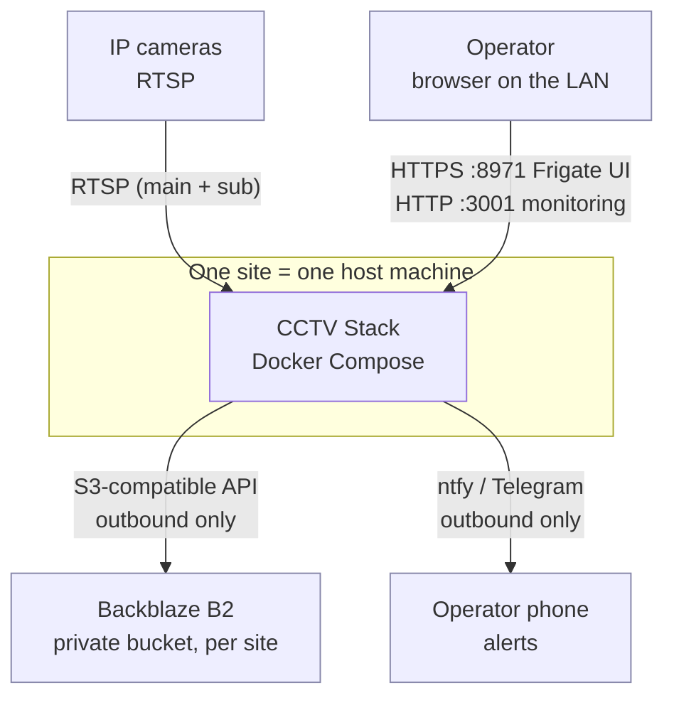
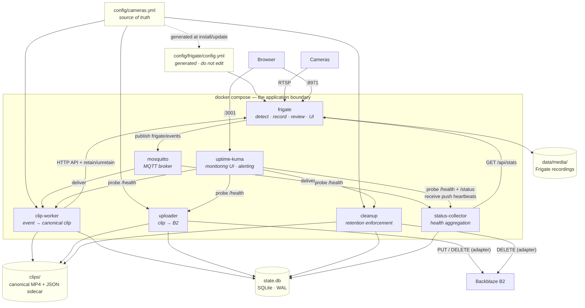
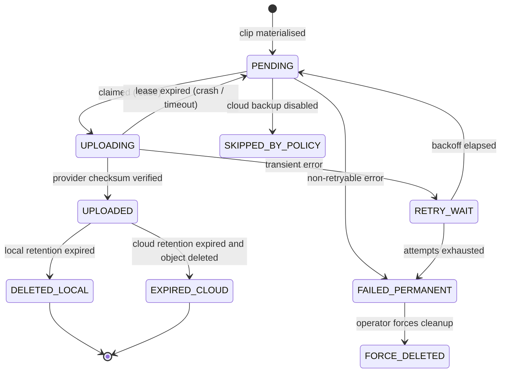

# High-level design

> Status: 📐 Draft for review. Companion documents:
> invariants.md · contracts/ · LLDs/ · ADRs/

---

## 1. Purpose

Define the architecture of a **packaging-first CCTV system**: one repository, one
installer, one deployment per site, with Frigate as the detection and recording
engine and a small set of purpose-built services providing the durability,
retention, and observability guarantees Frigate intentionally does not.

An operator at a new location should need to supply: a machine with Docker, the
repository, and answers to a short set of questions. Nothing else.

### 1.1 Goals

| Goal | Success looks like |
|---|---|
| G1 — Single-command install | `./install.sh` on a fresh machine produces a healthy, recording stack |
| G2 — Portability | The same commit deploys at a home, a parents' home, and a business, differing only in `.env` and `config/cameras.yml` |
| G3 — Durability | A clip that exists locally is eventually in B2, or an alert explains precisely why it is not |
| G4 — Predictable retention | Local 90d and cloud 60d enforced by one service, safely (see [INV-1](invariants.md)) |
| G5 — Honest health | One endpoint answers "is my CCTV working?" with per-camera and per-component truth |
| G6 — Zero-drift config | Adding a camera is a config edit with no code change |
| G7 — Safe lifecycle | Install, update, uninstall, backup, and restore are scripts, not procedures |
| G8 — Open-sourceable | A stranger can clone, run, and contribute without private context |

### 1.2 Non-goals (explicitly out of scope for v1)

- **Continuous cloud backup of all footage.** We back up *clips* (events), not the
  24/7 recording archive. The PRD is explicit (§14) and the cost would be absurd.
- **A central multi-site hub.** Sites are independent by decision
  ([ADR-0002](../adr/0002-independent-per-site-deployments.md)). A read-only status
  export is left as a possible future extension, but nothing shares data today.
- **Replacing Frigate's UI.** Live view, playback, review browsing, and exports
  remain Frigate's job. We link to it.
- **Reinventing detection.** No custom ML, no custom object tracking, no
  re-encoding of video.
- **A mobile app.**
- **Kubernetes, Swarm, or any orchestrator beyond Docker Compose.** Compose *is*
  the deployment boundary (PRD §4).
- **Windows-native support.** Windows hosts are supported only via Docker Desktop
  with the WSL2 backend, documented as best-effort (see §9.2).
- **Facial recognition, license plates, semantic search.** Available in Frigate and
  therefore usable, but not something we configure, wrap, or guarantee.

### 1.3 Constraints inherited from the PRD

These are requirements, not preferences. Each is honoured somewhere below.

| ID | Constraint | Honoured by |
|---|---|---|
| C1 | Repository contains the application; host holds only configuration | §8, §9 |
| C2 | `./install.sh` validates, starts, verifies | §9.3 |
| C3 | Compose is the deployment boundary | §4 |
| C4 | Containers disposable; data in predictable host dirs | §9.1, [INV-4](invariants.md) |
| C5 | Cameras are data, not code | §8.1, [INV-3](invariants.md) |
| C6 | Canonical clip layout `clips/<camera>/YYYY/MM/DD/HH-MM-SS.mp4` | §6, [ADR-0006](../adr/0006-canonical-clip-layout.md) |
| C7 | Cloud storage behind an adapter | §7.3, [ADR-0005](../adr/0005-b2-behind-storage-adapter.md) |
| C8 | Upload is a durable state machine with retry | §6.4 |
| C9 | Cleanup is its own service, local 90d + cloud 60d | §6.5 |
| C10 | Health is first-class | §6.6, §11 |
| C11 | No secrets in the repository | §13, [INV-2](invariants.md) |
| C12 | Versioned application with `./update.sh` | [lld/09](lld/09-upgrade-and-versioning.md) |
| C13 | Backup covers config, DB, state; not the video archive | §6.7 |

---

## 2. Why this shape

Three facts about upstream drive almost every decision here.

**Fact 1 — Frigate does not store event clips as files.**
`frigate/events/cleanup.py` contains `file_extension = None  # mp4 clips are no
longer stored in /clips`. An event clip is cut on demand by ffmpeg from the
recording segments when `GET /api/events/{id}/clip.mp4` is called. This means:

- The canonical `clips/<camera>/…` tree from PRD §7 **cannot** be produced by
  Frigate. It requires a dedicated component — the **clip-worker**.
- Frigate's own retention can expire the source footage out from under us. So the
  pipeline must *materialise promptly* and must be able to *pin* an event to buy
  time. That is [INV-9](invariants.md), and it is why the clip-worker calls
  `retain` before it downloads.

**Fact 2 — Frigate already solves detection, recording, review, and its own UI.**
Building any of it ourselves would be months of work to reach parity. Instead we
treat Frigate as a subsystem behind a contract
([`contracts/frigate-integration.md`](contracts/frigate-integration.md)).

**Fact 3 — Frigate emits a rich event stream and a full REST API with role-based
auth.** We therefore drive our pipeline from events (low latency) *and*
reconcile from the API (correctness), rather than watching the filesystem. This is
[ADR-0007](../adr/0007-mqtt-api-over-filesystem-watching.md).

---

## 3. System context



**Everything is inbound-free.** The stack makes outbound connections to B2 and to
notification services. There is no requirement to expose anything to the internet,
and remote access is deliberately left to the operator (Tailscale/WireGuard
recommended — see §13.4).

---

## 4. Container view

Compose is the deployment boundary. Every box below is a compose service; every
arrow is a documented contract.



### 4.1 Component responsibilities

| Component | Owns | Does **not** do |
|---|---|---|
| **frigate** | Camera ingest, detection, recording, review, snapshots, its own UI, its own DB | Know anything about B2, our retention, or our health model |
| **mosquitto** | Event transport between Frigate and our services | Anything else. Writes no state we must back up |
| **clip-worker** | Turning a completed event into exactly one canonical clip; pinning events; reconciliation sweep | Uploading. Deciding retention. Deleting anything |
| **status-collector** | The single aggregated answer to "is my CCTV working?"; per-camera state; push heartbeats to Uptime Kuma | Being the alerting engine (Uptime Kuma alerts) |
| **uploader** | The upload state machine: claim, upload, verify, record, retry with backoff | Deciding local retention. Touching files it does not own |
| **cleanup** | Local and cloud retention enforcement; reconciliation reporting | Deleting anything not in a terminal-success upload state |
| **uptime-kuma** | Monitoring dashboard, notification delivery (ntfy, Telegram), status page | Owning any state we depend on for correctness |

> **Deliberate coupling reduction:** `clip-worker`, `uploader`, `cleanup`, and
> `status-collector` are four small Python services that share one internal
> library (config, DB access, path derivation, logging, health) and one SQLite
> database. They do **not** call each other. Coordination happens through
> database state, which is what makes the pipeline resilient to any one of them
> being down.

---

## 5. Deployment topology

### 5.1 Single host, one site

One host per site, running one Compose project. There is no cluster, no shared
storage, and no cross-site network dependency
([ADR-0002](../adr/0002-independent-per-site-deployments.md)).

### 5.2 Host profile (detect and confirm)

Because v1 must run on a Raspberry Pi, an x86 mini-PC, an ARM Mac (for
development), and Windows-via-WSL2, the installer derives a **host profile** and
asks the operator to confirm before proceeding.

```text
Detect → propose → confirm → enable compose profile → generate config
```

| Profile field | Detected from | Drives |
|---|---|---|
| Architecture | `uname -m` | Image tags (`amd64` / `arm64`) |
| GPU / iGPU | `/dev/dri`, `lspci`/`system_profiler` | `hwaccel_args` for decode |
| Accelerator | USB VID/PID scan, `/dev/apex_0`, `hailo` CLI | Frigate `detectors:` block |
| CPU flags | `/proc/cpuinfo` | VAAPI / QSV / OpenVINO / RKNN choice |
| RAM | `/proc/meminfo` | Frigate `shm_size`, worker concurrency |
| Storage | mount table + free space | `DATA_DIR`, retention warnings |
| Docker runtime | `docker info` | WSL2 detection, socket path |

The operator always sees the proposal and can override it:

```text
Detected host profile
─────────────────────
  Architecture   arm64 (aarch64) — Raspberry Pi 5
  Accelerator    none detected            ⚠ CPU detection will be slow
  No Coral Edge TPU found on USB or PCIe
  Memory         8.0 GiB
  Storage        /srv/cctv — 412 GiB free on ext4

Recommended profile: pi-cpu
  → 3 cameras maximum at 640×360 detection resolution
  → continuous recording disabled by default

Proceed with this profile? [Y/n/override]
```

This is [ADR-0012](../adr/0012-host-profile-detection.md) and is specified in
[`lld/07-installer-and-host-profiles.md`](lld/07-installer-and-host-profiles.md).

### 5.3 Compose profiles, not many compose files

One `compose.yml` with profiles keeps the "deployment boundary is one file"
property while allowing hardware-specific service variants.

| Profile | Adds | When |
|---|---|---|
| `core` (always) | frigate, mosquitto, clip-worker, uploader, cleanup, status-collector | Always |
| `monitoring` | uptime-kuma | Default on |
| `hwaccel-intel` | device mappings + VAAPI/OpenVINO config | Intel iGPU present |
| `hwaccel-coral` | USB/PCIe passthrough for Edge TPU | Coral present |
| `hwaccel-hailo` | Hailo device mapping | Hailo present |
| `hwaccel-rknn` | `/dev/rknpu` mapping | Rockchip SoC |
| `dev-synthetic` | a synthetic RTSP source instead of real cameras | Development and CI |

See [ADR-0013](../adr/0013-compose-profiles.md).

---

## 6. Canonical data flows

### 6.1 Clip lifecycle, end to end

```mermaid
sequenceDiagram
    autonumber
    participant F as frigate
    participant M as mosquitto
    participant W as clip-worker
    participant DB as state.db
    participant U as uploader
    participant B2 as Backblaze B2
    participant C as cleanup

    F->>M: publish frigate/reviews (type=end)
    M->>W: deliver review item
    W->>W: end_time non-null, severity and labels pass the per-camera filter?
    W->>F: POST /api/events/{id}/retain — once per id in data.detections
    Note over W,F: source footage pinned — INV-9 satisfied
    W->>W: schedule fetch at review.end + post_roll + flush_grace
    Note over W: never fetch before the segment is flushed — INV-14
    W->>F: GET /api/{camera}/start/{review.start−pre}/end/{review.end+post}/clip.mp4
    F-->>W: fragmented MP4, cut from recordings by ffmpeg
    W->>W: remux (-map 0 -c copy -movflags +faststart)
    W->>W: measure coverage + gaps; retry if short, keep the best — INV-14
    W->>W: write to .tmp, fsync, atomic rename into clips/<camera>/YYYY/MM/DD/
    W->>W: sha256 + size + ffprobe duration
    W->>DB: INSERT clip (UNIQUE review_id, upload_state=PENDING)
    W->>F: DELETE /api/events/{id}/retain — unpin each event
    Note over W,F: pin released after our copy is durable

    U->>DB: claim PENDING rows (lease)
    U->>DB: mark UPLOADING (lease expires if we die)
    U->>B2: PUT deterministic object key
    B2-->>U: object id + provider checksum
    U->>U: verify checksum matched
    U->>DB: mark UPLOADED

    C->>DB: SELECT clips older than 90d AND state='UPLOADED'
    C->>C: unlink local file
    C->>DB: mark DELETED_LOCAL
    C->>DB: SELECT clips older than 60d AND state='UPLOADED'
    C->>B2: DELETE object
    C->>DB: mark state='EXPIRED_CLOUD'
```

Note the ordering: **pin first, download second, unpin last.** If we crash anywhere
in the middle, the worst case is an event left pinned in Frigate (wasting a little
disk) rather than an event lost forever.

### 6.2 The reconciliation backstop

MQTT delivery is the fast path, but it is at-most-once from our perspective: a
broker restart, a network blip, or a service downtime can drop a message. Losing a
message must never mean losing a clip.

The **clip-worker runs a periodic sweep**:

```text
GET /api/review?after=<last_sweep_watermark>&before=<now>
  → for each review with a non-null end_time not present in state.db:
       enqueue materialisation
  → advance watermark only after every review in the batch is durably recorded
```

The watermark is stored in the database, so a restart resumes rather than redoing. This
sweep also covers the case Frigate creates for us: its review maintainer clears any
review still open at its own start-up, so a review interrupted by a Frigate restart can
never deliver a `type: end`. The sweep is the correctness mechanism; MQTT is the latency
optimisation. Same pattern applies to Frigate's own state being unavailable: we simply
sweep later.

### 6.3 Why uploads do not follow "file appears → upload → delete"

PRD §9 explicitly rejects the naive pipeline. The concrete reasons:

- **Restart safety.** The queue is in SQLite, not in memory. A host reboot
  mid-upload resumes from the last committed state.
- **Backoff.** Transient B2 errors (`503`, network timeouts) retry with exponential
  backoff and jitter; permanent errors (auth failure, bucket missing) fail fast and
  alert rather than hammering the API.
- **No premature deletion.** Because upload state is separate from file existence,
  cleanup has something to consult. This is the mechanism that satisfies
  [INV-1](invariants.md).
- **Observability.** "How many clips are pending, how many failed, how old is the
  oldest pending" is directly queryable, and is what the dashboard shows.

### 6.4 Upload state machine



`SKIPPED_BY_POLICY` exists so that a deliberately local-only deployment is
distinguishable from a broken one. See
[`contracts/database-schema.md`](contracts/database-schema.md) for the full
definition and [`lld/04-uploader.md`](lld/04-uploader.md) for the retry policy.

### 6.5 Retention: two mechanisms, deliberately overlapping

| Layer | Mechanism | Scope | Enforcement |
|---|---|---|---|
| Local | `cleanup` service | `clips/` only | DB-driven; requires terminal-success upload state |
| Cloud (primary) | `cleanup` service | Objects under this site's prefix | DB-driven, exact |
| Cloud (backstop) | B2 lifecycle rules | Prefix-scoped to this site | Provider-side, once per day |

The B2 lifecycle rule is scoped by object-key prefix so it can never touch another
site's data. It runs with a **grace period longer than the application's**, so the
application normally acts first and the lifecycle rule only catches objects that
escaped bookkeeping ([INV-10](invariants.md)).

Two mechanisms rather than one is intentional: application cleanup is exact and
fast, provider lifecycle is independent of our code being correct.

> ⚠️ **The recording archive is not covered by our retention.** Frigate manages
> its own recordings with its own `record:` retention config. We generate a
> deliberately conservative default (short motion retention, continuous disabled)
> because 24/7 retention is the single easiest way to fill a disk. Operators who
> want continuous recording must opt in and will see a capacity warning.

### 6.6 Health aggregation

```text
             frigate /api/stats ──┐
   frigate/<camera>/status/<role> ─┤
               each service /health ─┤──► status-collector ──► /status (JSON + HTML)
              state.db queue depth ──┤            │
                  host disk space ───┘            └──► Uptime Kuma push heartbeats
                                                              │
                                                              └──► ntfy / Telegram
```

`status-collector` is the only component that knows the whole picture. It exposes
one endpoint designed to be read by a human in five seconds, and it pushes
heartbeats to Uptime Kuma so that any failure — including the collector's own
death — becomes an alert. See [`lld/06-health-and-monitoring.md`](lld/06-health-and-monitoring.md).

### 6.7 Backup scope

Per PRD §14, backup is about *state*, not *footage*.

| Included | Excluded |
|---|---|
| `compose.yml`, `config/` (including `cameras.yml`) | `data/media/` — huge, and recoverable by definition |
| `.env` (secrets — must be handled as a secret) | `data/clips/` — already in B2 by design |
| `state.db` + upload queue | Frigate's own `frigate.db` — a cache, rebuildable |
| Camera definitions, upload state | Docker images, model caches |

The restore story is: new machine → `install.sh` → restore `config/` + `.env` →
restore `state.db` → `uploader` reconciles local files it no longer has against the
cloud.

---

## 7. Data ownership and lifecycle

| Data | Owner | Location | Retention | Backup | Rebuildable? |
|---|---|---|---|---|---|
| Camera config | Operator | `config/cameras.yml` | n/a | ✅ yes | No — must be backed up |
| Generated Frigate config | Generator | `config/frigate/config.yml` | n/a | Optional | Yes — regenerate |
| Recording segments | Frigate | `data/media/recordings/` | Frigate `record:` config | ❌ no | No (by design) |
| Event snapshots | Frigate | `data/frigate/clips/` | Frigate `snapshots:` config | ❌ no | No |
| **Canonical clips** | clip-worker | `data/clips/` | 90d local | ❌ no | **Yes — from B2** |
| Clip metadata | clip-worker | `state.db` | Forever | ✅ yes | Partially — re-derivable from cloud listing |
| Upload queue | uploader | `state.db` | Until terminal | ✅ yes | No |
| Frigate's own DB | Frigate | `data/frigate/frigate.db` | n/a | ❌ no | Yes — cache |
| Health history | status-collector | `state.db` (ring buffer) | 7d | ❌ no | Yes |
| MQTT messages | — | — | Ephemeral | ❌ no | n/a |

The critical asymmetry: **clips are rebuildable from the cloud, but upload *state*
is not rebuildable from anything except a good backup of `state.db`.** That is why
`state.db` is the centre of the backup strategy.

---

## 8. Configuration model

### 8.1 Three layers

```text
Layer 1 — Application defaults        (in the repository, same everywhere)
  config/app.yml
  └─ 90d local retention, 60d cloud retention, retry policy, health thresholds

Layer 2 — Site identity + secrets      (in .env, differs per site, chmod 600)
  .env
  └─ LOCATION, DATA_DIR, TZ, B2_BUCKET, B2_KEY_ID, B2_APPLICATION_KEY,
     notification tokens, Frigate admin credentials

Layer 3 — Cameras and detection        (in config/cameras.yml, differs per site)
  config/cameras.yml
  └─ camera names, RTSP URLs, credentials, detect/record/notify policy
```

Precedence: `app.yml` → overridden by `.env` → overridden by `cameras.yml` for
camera-scoped values only. A value may only be defined at the layer that owns it;
validation rejects a camera name in `.env` or a B2 key in `cameras.yml`.

### 8.2 Generated artefacts

| Artefact | Source | Regenerated when |
|---|---|---|
| `config/frigate/config.yml` | `cameras.yml` + `app.yml` + `.env` | Install, update, any camera change |
| `config/frigate/mqtt.yml` (or inline) | `.env` MQTT credentials | Install, update, credential rotation |
| `config/cleanup/retention.yml` | `app.yml` + `cameras.yml` overrides | Install, update |
| `config/uptime-kuma/monitors.json` | generated then imported via API | Install, camera add/remove |
| `.env` (interactive) | installer Q&A | Install |

Every generated file starts with:

```yaml
# GENERATED FILE — DO NOT EDIT
# Source:    config/cameras.yml
# Generator: cctv-stack <version>
# Regenerate: ./update.sh --regenerate-config
```

### 8.3 Why `cameras.yml` and not `.env` for cameras

The PRD's illustrative `.env` uses `CAMERA_1_NAME` / `CAMERA_1_RTSP`. That does not
survive contact with reality:

- No structure: RTSP mains, subs, per-camera detect policy, zones, and credentials
  cannot be expressed without an explosion of numbered keys.
- No validation: a typo in `CAMERA_3_RTSP` is invisible.
- No diffability: reordering cameras creates meaningless diffs.
- No nesting: this is what YAML is for.

`.env` keeps what `.env` is good at — single-valued, secret, and
infrastructure-specific settings. Cameras live in YAML. See
[ADR-0003](../adr/0003-cameras-yml-single-source-of-truth.md) and
[`contracts/cameras-config-schema.md`](contracts/cameras-config-schema.md).

---

## 9. Host layout and installation

### 9.1 Host directory layout

```text
/opt/cctv/                      # DATA_DIR — the only thing that must survive
├── config/                     #   generation output + camera source of truth
│   ├── cameras.yml             #   ← operator edits this
│   ├── app.yml
│   └── frigate/config.yml      #   generated
├── data/
│   ├── clips/                  #   OUR canonical clips — Frigate never writes here
│   ├── media/                  #   Frigate's /media/frigate: recordings, snapshots, exports
│   ├── frigate/                #   Frigate's /config: frigate.db, model cache, go2rtc
│   └── state/                  #   OUR state.db, WAL, tmp, db-backups
├── logs/                       #   optional aggregated logs
└── backups/                    #   backup.sh output

<repo>/                         # the checkout — disposable, re-clonable
├── compose.yml
├── .env                        # ← operator secrets, chmod 600, gitignored
├── install.sh  update.sh  uninstall.sh  backup.sh
└── services/  config/  docs/  scripts/
```

`DATA_DIR` is configurable and the installer asks for it, defaulting to `/opt/cctv`
on Linux. It must be on a single filesystem — the installer checks, because several
stages rely on atomic rename and hardlink behaviour that break across mounts.

### 9.2 Support matrix

| Host | Status | Notes |
|---|---|---|
| Linux x86_64 (Debian/Ubuntu) | **Primary** | Intel iGPU and Coral are the best-supported paths |
| Raspberry Pi 4/5 (arm64) | **Supported, capacity-limited** | Installer enforces camera/ resolution limits for CPU detection; recommends Coral or Hailo |
| Other arm64 Linux (Rockchip) | Best effort | RKNN detector profile |
| macOS (Apple Silicon) | **Development only** | Requires the external `apple-silicon-detector` ZMQ client; not a deployment target |
| Windows | Best effort via Docker Desktop + WSL2 | Requires WSL2 backend with systemd; USB passthrough limited; documented as such |

The installer detects the host, states clearly which row of this table it matched,
and asks for confirmation. It never silently proceeds on an unsupported platform.

### 9.3 Install sequence

```text
./install.sh
  1. Preflight        docker present + version + compose v2 + permissions
  2. Host profile     detect arch/GPU/accelerator/RAM/storage → propose → confirm
  3. Storage          validate DATA_DIR exists, is writable, single fs, has space
  4. Interview        LOCATION, timezone, cameras, B2 credentials, notifications
  5. Validate         schema + naming rules + RSTP URI syntax + retention sanity
  6. Generate         config/frigate/config.yml, service configs, Uptime Kuma monitors
  7. Provider setup   verify bucket reachable, apply scoped lifecycle rule
  8. Pull             images by pinned digest
  9. Start            compose up -d in dependency order
 10. Verify           wait for each component /health; probe one camera; time-boxed
 11. Report           URLs, next steps, and any warnings that are not fatal
 12. Doctor           write a diagnostics bundle to logs/ for support
```

Steps 5 and 6 are the ones that make step 8 safe
([INV-11](invariants.md)). Step 10 is the one that makes step 12 honest.

### 9.4 Idempotency

`install.sh` is safe to re-run. It detects existing configuration, offers to keep
or change it, and never regenerates a file the operator has deliberately taken
ownership of. `update.sh` performs the same sequence minus the interview.

---

## 10. Network and ports

| Port | Service | Exposure | Purpose |
|---|---|---|---|
| `8971` | frigate | **Published**, LAN only | Frigate's authenticated UI (playback, review, exports) |
| `5000` | frigate | Internal only | Frigate's unauthenticated API — never published |
| `1883` | mosquitto | Internal only | MQTT, authenticated, anonymous disabled |
| `1984` | frigate (go2rtc) | Internal only | Restream |
| `3001` | uptime-kuma | **Published**, LAN only | Monitoring dashboard + status page |
| `8080` | status-collector | **Published**, LAN only | `/status` human view, `/health`, `/metrics` |
| `8081` | clip-worker | Internal only | `/health`, `/metrics` |
| `8082` | uploader | Internal only | `/health`, `/metrics`, `/admin/retry` |
| `8083` | cleanup | Internal only | `/health`, `/metrics` |
| `8554` | frigate | Optional profile | RTSP restream for third-party clients |
| `8555` | frigate | Optional profile | WebRTC |

Rules:

- Only three ports are published by default, all LAN-scoped. Everything else is on
  an internal compose network.
- Host port values are configurable via `.env`; the installer checks for conflicts
  before starting rather than failing at `docker compose up`.
- Frigate's port `5000` must never be published: it bypasses authentication
  entirely. A validation check fails the install if `.env` tries.

---

## 11. Health and observability model

### 11.1 The five states

Defined in [`glossary.md`](../glossary.md#state-vocabulary): `HEALTHY`, `DEGRADED`,
`UNHEALTHY`, `UNKNOWN`, `DISABLED`. Cameras reuse Frigate's `ONLINE` / `OFFLINE` /
`DISABLED`.

### 11.2 What "is my CCTV working?" actually decomposes into

| Question | Answered by | Reported as |
|---|---|---|
| Are the cameras reachable? | Frigate `frigate/<cam>/status/<role>` | per-camera `ONLINE`/`OFFLINE` |
| Is detection running? | Frigate `/api/stats` (detection FPS, inference speed) | `DEGRADED` if inference can't keep up |
| Are clips being produced? | clip-worker: time since last canonical clip per camera | `DEGRADED` if a camera that normally produces clips goes quiet |
| Is anything stuck uploading? | uploader: oldest `PENDING` age, `FAILED` count | `DEGRADED`/`UNHEALTHY` |
| Is backup actually happening? | last successful upload timestamp | `UNHEALTHY` if stale beyond threshold |
| Will we run out of disk? | host disk free, projected days-to-full | `DEGRADED` below threshold |
| Can we still recover footage? | uploader success rate over trailing window | `DEGRADED` |
| Is retention intact? | cleanup last run, `clips_overdue_retention` | `DEGRADED` if non-zero |

The last three are the ones that distinguish this from a container-liveness check,
and they are precisely what the PRD asks for.

### 11.3 Alerting

Uptime Kuma owns alert delivery, configured with **ntfy** and **Telegram** by the
installer. Alert-worthy transitions are limited to a small set to avoid noise:
camera offline beyond a grace period, uploader stale, disk pressure, any component
`UNHEALTHY`, and Frigate unavailable. Recovery notifications are enabled
throughout — an alert that never clears is worse than no alert.

---

## 12. Failure modes and degraded operation

The design principle: **local recording must survive the failure of every one of
our components.** Frigate alone is enough to keep recording. Everything we add must
be able to be down for hours without permanent loss.

| Failure | Impact | System behaviour | Operator-visible signal |
|---|---|---|---|
| Camera offline | That camera only | Frigate retries the stream; other cameras unaffected | Camera `OFFLINE`, alert after grace period |
| Frigate container down | No ingest, no new clips | Compose restarts it; uploader keeps draining the queue; events already pinned are safe | `UNHEALTHY`, Frigate monitor down |
| MQTT broker down | Events delayed, not lost | clip-worker sweep finds events by API once the broker returns | `DEGRADED`, sweep lag |
| clip-worker down | Clips not materialised | Events are **not** pinned during downtime → risk window. Frigate's recording retention is the clock. Sweep catches up on restart | `UNHEALTHY`, retention headroom shrinking |
| `state.db` unavailable | Uploads and cleanup pause | clip-worker stops materialising (deliberately — it cannot dedupe safely) and leaves events for the sweep. Nothing is deleted (cleanup is DB-driven and therefore inert) | `UNHEALTHY` |
| B2 unreachable | Uploads queue | Exponential backoff indefinitely; **clips never deleted** (INV-1); `clips_overdue_retention` rises and alerts | `DEGRADED`, then `UNHEALTHY` if stale |
| B2 credentials revoked | Uploads fail permanently | Fast-fail, stop retrying, alert loudly with the exact error | `UNHEALTHY`, `FAILED_PERMANENT` count |
| Disk full | **Highest-severity failure** | Frigate's own emergency cleanup deletes oldest recordings when <1h of space remains. Our clips are protected by retention but new clips cannot be written | `UNHEALTHY`, projected-days-to-full alert before it happens |
| Host power loss | In-flight work lost | SQLite WAL recovers; expired leases are re-claimed; partial `.tmp` files are reaped on startup | Recovery logged, no data loss |
| Clock skew | Wrong clip names, DST bugs | Validation warns if NTP is not synchronised; path function is timezone-explicit | `DEGRADED` warning |
| Wrong/absent timezone | Clip paths off by hours | Installer requires an explicit timezone; defaults are not guessed from the host | Validation error |
| Uptime Kuma down | No dashboard, no alerts | Recording, clips, and upload are unaffected. This is a monitoring failure, not a data failure | Its own monitor goes down (external) |

**Disk capacity is the failure we care most about**, because it is the only one
that can destroy *both* new clips and Frigate's recordings, and because it degrades
gracefully right up until it is catastrophic. Hence: projected-days-to-full is a
first-class health metric, and the default Frigate recording retention is short.

---

## 13. Security posture

### 13.1 Threat model

In scope: credential leakage from the repository, unauthorised LAN access,
credential exposure in logs, accidental destruction of footage, supply-chain drift
in images.

Out of scope: a compromised host OS, physical access to the machine, a compromised
camera, nation-state adversaries, and DDoS.

### 13.2 Controls

| Control | Detail |
|---|---|
| No published secrets | [INV-2](invariants.md); `.gitignore`, pre-commit scan, CI scan, redacting config objects |
| API surface | Internal container network for everything except Frigate's authenticated UI, Uptime Kuma, and the status page |
| Frigate auth | Enabled; port `5000` never published; a dedicated service credential is created by the installer |
| MQTT auth | Username/password generated at install; anonymous access disabled; broker not published |
| Cloud | Private bucket, per-site prefix, scoped lifecycle rules, least-privilege application key (read/write on one bucket only) |
| Host files | `.env` and `state.db` written `chmod 600`; installer refuses world-readable `.env` |
| Container privilege | No `privileged: true` except where hardware passthrough strictly requires it, and never for our own services |
| Docker socket | **Never mounted raw.** If container state is needed, a read-only socket proxy is used. Our services do not need it — HTTP health is sufficient |
| Image supply chain | Digests pinned ([ADR-0014](../adr/0014-pinned-image-digests.md)), no `:latest` |
| Upgrades | `update.sh` only moves between known versions with a migration path |

### 13.3 Data at rest

Clips are stored unencrypted on the host and in B2 (provider-side encryption is
available and should be enabled by the operator; documented in the install
runbook). Application-level encryption of clips is **not** in v1 — it would break
range playback and add key management we cannot yet do well. Recorded as a
conscious limitation.

### 13.4 Remote access

Not built by us, and deliberately so. The recommended patterns, in order:

1. **Tailscale / WireGuard** — no ports exposed, device-level auth. Recommended.
2. **Reverse proxy with TLS + auth** in front of Frigate's UI.
3. Port forwarding — discouraged; documented only so operators know what they are
   accepting.

This is documented in the install runbook rather than implemented, keeping the
stack out of the "expose my cameras to the internet" business.

---

## 14. Capacity planning

### 14.1 Formulas

```text
clip_size_MB        = clip_duration_s × bitrate_Mbps / 8
daily_clip_MB       = events_per_day × clip_size_MB
local_clips_GB      = daily_clip_MB × local_retention_days / 1024
cloud_clips_GB      = daily_clip_MB × cloud_retention_days / 1024
continuous_GB_per_d = bitrate_Mbps × 86400 / 8 / 1024
```

### 14.2 Reference figures

At 2 Mbps encoding, 100 events/day, 30 s average clip (≈7.5 MB each):

| | Value |
|---|---|
| Clips per day | ≈ 750 MB |
| Local, 90 days | ≈ 66 GB |
| Cloud, 60 days | ≈ 44 GB |
| **Continuous recording** per camera | **≈ 21 GB / day, ≈ 1.9 TB / 90 days** |

That last row is the point: continuous retention is two orders of magnitude more
expensive than clip retention. It is why the generated default is continuous
recording **disabled**, and why the installer prints a capacity projection before
the operator commits.

### 14.3 Installer capacity check

The installer:

1. Asks for camera count and detection resolution.
2. Reads the operator's intended Frigate recording mode.
3. Projects 90-day local clip usage and Frigate recording usage.
4. Compares against free space with a safety margin.
5. Warns, or refuses, if the projection exceeds available space — and states the
   numbers, because "insufficient storage" without arithmetic is useless.

A runtime monitor then tracks actual usage against the projection and alerts on
divergence, since real event rates are always different from the estimate.

---

## 15. Technology choices

| Concern | Choice | ADR |
|---|---|---|
| Detection / recording | Frigate | [0001](../adr/0001-frigate-as-detection-engine.md) |
| Event transport | MQTT (mosquitto) | [0007](../adr/0007-mqtt-api-over-filesystem-watching.md) |
| Custom services | Python 3.12+ | [0011](../adr/0011-python-fastapi-services.md) |
| HTTP services | FastAPI + uvicorn | [0011](../adr/0011-python-fastapi-services.md) |
| State store | SQLite (WAL) | [0004](../adr/0004-sqlite-for-state.md) |
| Cloud | Backblaze B2 via S3-compatible API | [0005](../adr/0005-b2-behind-storage-adapter.md) |
| Monitoring UI + alerting | External tool: Gatus (recommended) or Uptime Kuma | [0010](../adr/0010-external-monitoring-tool.md) |
| Deployment | Docker Compose with profiles | [0013](../adr/0013-compose-profiles.md) |
| Packaging | Shell installer + Python helpers | [0012](../adr/0012-host-profile-detection.md) |

### 15.1 Images

| Image | Notes |
|---|---|
| `ghcr.io/blakeblackshear/frigate` | Variant chosen by host profile (`-standard-arm64`, `-tensorrt`, `-rocm`, …) |
| `eclipse-mosquitto` | Broker |
| `louislam/uptime-kuma` | Monitoring |
| `ghcr.io/<owner>/cctv-stack` | One image, four entrypoints, for our own services |

Our four services ship as **one image with four entrypoints**. They share the same
internal library, so four images would quadruple build, scan, and pin overhead for
no isolation benefit. They still run as four compose services with four independent
health endpoints and resource limits, so a runaway uploader cannot starve the
clip-worker.

---

## 16. Traceability to the PRD

| PRD | Requirement | Design | Status |
|---|---|---|---|
| §1 | Package everything as one application | §4, §9.1 | 📐 |
| §2 | Separate application from machine configuration | §8 | 📐 |
| §3 | Extremely simple installation | §9.3 | 📐 |
| §4 | Compose is the deployment boundary | §4, [ADR-0013](../adr/0013-compose-profiles.md) | 📐 |
| §5 | Persistent data outside containers | §9.1, [INV-4](invariants.md) | 📐 |
| §6 | Camera configuration is data, not code | §8.3, [INV-3](invariants.md) | 📐 |
| §7 | Standardised event output | §6.1, [ADR-0006](../adr/0006-canonical-clip-layout.md) | 📐 |
| §8 | Cloud storage as an adapter | §4, [ADR-0005](../adr/0005-b2-behind-storage-adapter.md) | 📐 |
| §9 | Reliable uploading | §6.3, §6.4 | 📐 |
| §10 | Cleanup as its own service | §6.5 | 📐 |
| §11 | Health as a first-class feature | §11 | 📐 |
| §12 | No secrets in the repository | §13.2, [INV-2](invariants.md) | 📐 |
| §13 | Versioning and updates | [lld/09](lld/09-upgrade-and-versioning.md) | 📐 |
| §14 | Backup and restore | §6.7, [lld/08](lld/08-backup-and-restore.md) | 📐 |
| §15 | The ideal end state | §9.3 | 📐 |

**Gaps in the PRD that this design closes** (the PRD did not specify them, but they
are required for the system to be correct):

| Gap | Where addressed |
|---|---|
| What a "clip" is, given Frigate stores none as files | §2 Fact 1, §6.1 |
| **Clip boundaries: pre-roll, post-roll, and the segment-flush race** | §6.1, [INV-14](invariants.md), [ADR-0015](../adr/0015-clip-boundaries-and-padding.md) |
| Cleanup must never delete un-uploaded clips | [INV-1](invariants.md), §6.4 |
| Missed MQTT messages must not lose clips | §6.2 |
| Frigate's recording retention can expire source footage | [INV-9](invariants.md) |
| Disk exhaustion is the highest-severity failure | §12, §14.3 |
| Alerting (appears only in the PRD's diagram) | §11.3 |
| Remote access / TLS | §13.4 |
| Timezone policy | [INV-12](invariants.md) |
| Multi-architecture and multi-OS support | §5.2, §9.2 |
| How to test without real cameras | §5.3 (`dev-synthetic` profile) |
| Database, migrations, upgrade ordering | [lld/03](lld/03-state-store.md), [lld/09](lld/09-upgrade-and-versioning.md) |
| Local-only (no cloud) degraded mode | §6.4 (`SKIPPED_BY_POLICY`) |

---

## 17. What is deliberately deferred

Recorded here so they are decisions, not oversights.

| Deferred | Rationale | Revisit when |
|---|---|---|
| Cloud providers other than B2 | Adapter interface is in place; only one implementation is warranted now | A real second use case appears |
| Central multi-site dashboard | Sites are independent by decision | Explicit operator need |
| Clip-level encryption | Key management cost exceeds current threat model | Threat model changes |
| Prometheus + Grafana | Uptime Kuma answers the current question | Metric volume or history depth demands it |
| Semantic search / face / LPR surfacing | Frigate provides it; we do not need to wrap it | A concrete user story |
| Mobile app | ntfy and Telegram already deliver | — |
| Multi-disk / NAS storage pools | Single-filesystem assumption keeps atomic operations correct | Storage requirements outgrow one disk |
| Full continuous-recording backup | Cost-prohibitive by a wide margin | — |
