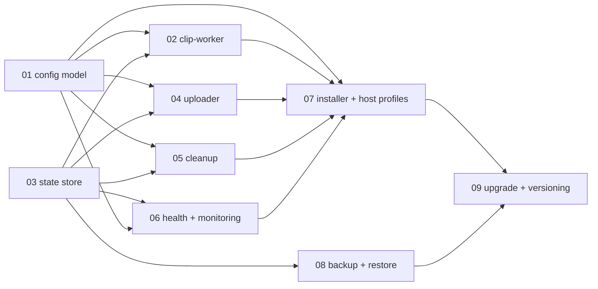

# LLD 00 — Overview

How the low-level designs fit together, in what order they should be built, and
what they share.

---

## 1. Component map and dependency order



**Build order** (each step is independently testable and each produces something
demonstrable):

| Step | Deliverable | Proves |
|---|---|---|
| 1 | Shared library + config model ([01](01-config-model.md)) | Configuration loads, validates, generates |
| 2 | State store ([03](03-state-store.md)) | Schema, migrations, claim query |
| 3 | clip-worker ([02](02-clip-worker.md)) | An event becomes a canonical clip |
| 4 | Uploader ([04](04-uploader.md)) | A clip becomes a cloud object, durably |
| 5 | Cleanup ([05](05-cleanup.md)) | Retention works and respects [INV-1](../invariants.md) |
| 6 | Health + monitoring ([06](06-health-and-monitoring.md)) | The system answers "is it working?" |
| 7 | Installer + host profiles ([07](07-installer-and-host-profiles.md)) | One command on a bare machine |
| 8 | Backup + restore ([08](08-backup-and-restore.md)) | The data can leave and come back |
| 9 | Upgrade + versioning ([09](09-upgrade-and-versioning.md)) | A machine can move forward safely |

Steps 1–3 constitute a useful system on their own (local clips in a sane layout).
That is deliberate: the first milestone should produce something the operator can
actually use, not a scaffold.

---

## 2. The shared internal library

One Python package, `cctv`, imported by all four services. It exists to make the
invariants structural rather than aspirational.

| Module | Provides | Invariants it enforces |
|---|---|---|
| `cctv.config` | Load, merge, validate, generate | [INV-3](../invariants.md), [INV-11](../invariants.md) |
| `cctv.paths` | **The** clip path function | [INV-5](../invariants.md) |
| `cctv.db` | Connection policy, migrations, query helpers | [INV-4](../invariants.md), [INV-8](../invariants.md) |
| `cctv.time` | UTC handling, timezone resolution | [INV-12](../invariants.md) |
| `cctv.health` | Check registry, state derivation, endpoint | [INV-6](../invariants.md) |
| `cctv.logging` | JSON logging, redaction | [INV-2](../invariants.md) |
| `cctv.secrets` | `.env` loading, redacting types | [INV-2](../invariants.md) |
| `cctv.storage` | `StorageAdapter` protocol + B2 implementation | [INV-7](../invariants.md), [INV-10](../invariants.md) |
| `cctv.frigate` | Frigate HTTP + MQTT clients | The integration contract |
| `cctv.atomic` | `write_atomic()`, `reap_tmp()` | Crash safety |

### 2.1 Why one library and not four implementations

Because [INV-5](../invariants.md) (one path function) and [INV-12](../invariants.md)
(one time policy) are only enforceable if there is literally one implementation.
The moment clip-worker and cleanup have their own path logic, they will diverge, and
divergence here means clips that cleanup cannot find.

### 2.2 Why one image, four entrypoints

The four services share ~all of the library. Four images would quadruple build time,
image scanning, and digest pinning for no isolation benefit. They remain four
compose services with separate health endpoints, resource limits, and mounts — which
is where isolation actually matters.

```dockerfile
# One image
ghcr.io/<owner>/cctv-stack:<version>
  /usr/local/bin/cctv-clip-worker
  /usr/local/bin/cctv-uploader
  /usr/local/bin/cctv-cleanup
  /usr/local/bin/cctv-status
```

---

## 3. Common service skeleton

Every service is the same shape. Deviations must be justified in its own LLD.

```text
main()
 ├─ configure logging (JSON, level from env)
 ├─ load + validate config            → exit 78 on failure
 ├─ create health registry            → /health serving UNHEALTHY immediately
 ├─ open DB, run migrations           → exit 75 on failure
 ├─ start HTTP server (health/metrics/admin)
 ├─ install signal handlers (SIGTERM, SIGINT, SIGHUP)
 ├─ start worker loop(s)
 └─ block until shutdown

worker loop
 ├─ do one bounded unit of work
 ├─ update health checks
 ├─ sleep with jitter (or wait on an event)
 └─ repeat until shutdown requested
```

### 3.1 Concurrency model

| Aspect | Choice |
|---|---|
| Runtime | Single Python process, `asyncio` where I/O-bound, with `asyncio.to_thread` for blocking file and subprocess work |
| HTTP | FastAPI + uvicorn in the same process, on a background task |
| Work units | Bounded and idempotent; every unit either completes or is safely retryable |
| Parallelism | Per-service concurrency limit (`fetch_concurrency`, `upload_concurrency`), default 2–4 |
| CPU work | `ffprobe`/`ffmpeg` via `asyncio.create_subprocess_exec`, never a shell string |
| Blocking | No blocking calls on the event loop; enforced by a lint rule |

**Why not multiprocessing:** the work is I/O-bound and the state is in SQLite.
Processes would add contention on the database and complicate shutdown for no gain.
If `ffmpeg` remuxing ever becomes CPU-bound, it runs as a subprocess, which is
already outside the interpreter's GIL.

### 3.2 Shutdown

```text
SIGTERM received
 ├─ stop accepting new work
 ├─ wait for in-flight units, up to stop_grace_period (30 s)
 ├─ release leases cleanly (UPDATE ... SET upload_state='PENDING' WHERE lease_owner=me)
 ├─ close DB connections
 ├─ stop HTTP server
 └─ exit 0
```

If the grace period expires, exit non-zero and let leases expire naturally. Nothing
is lost — a lease is a lock, not data.

---

## 4. Configuration knobs

Defaults live in `config/app.yml`. Only these should ever need to change:

| Key | Default | Service |
|---|---|---|
| `clip_worker.fetch_concurrency` | 2 | clip-worker |
| `clip_worker.fetch_timeout_s` | 120 | clip-worker |
| `clip_worker.remux` | `true` | clip-worker |
| `clip_worker.sweep_interval_s` | 300 | clip-worker |
| `clip_worker.sweep_page_size` | 100 | clip-worker |
| `clip_worker.sweep_overlap_s` | 600 | clip-worker |
| `clip_worker.max_pinned_events` | 500 | clip-worker |
| `clip_worker.pin_timeout_h` | 6 | clip-worker |
| `uploader.upload_concurrency` | 4 | uploader |
| `uploader.lease_seconds` | 900 | uploader |
| `uploader.max_attempts` | 12 | uploader |
| `uploader.backoff_base_s` / `backoff_max_s` | 15 / 3600 | uploader |
| `uploader.stale_upload_warn_s` | 1800 | uploader |
| `cleanup.run_interval_s` | 3600 | cleanup |
| `cleanup.reconcile_interval_s` | 86400 | cleanup |
| `cleanup.clips_overdue_warn` | 1 | cleanup |
| `storage.multipart_threshold_bytes` | 104857600 | uploader |
| `storage.verify_after_delete` | `true` | cleanup |
| `health.disk_warn_pct` / `disk_critical_pct` | 15 / 5 | all |

Every knob above must appear in `config/app.yml` with a comment explaining its
effect. A knob with no explanation is a knob nobody will dare change.

---

## 5. Testing strategy

| Level | Scope | How |
|---|---|---|
| Unit | Path function, config validation, backoff, state transitions | Pure functions, property tests |
| Contract | Frigate API/MQTT parsing | Recorded fixtures from a real Frigate instance; parser tolerance tests with unknown fields |
| Integration | Full pipeline | `dev-synthetic` profile + RustFS ([ADR-0019](../../adr/0019-rustfs-as-s3-test-double.md)); synthetic RTSP source generates deterministic events |
| Invariant | Each of INV-1…INV-13 | A dedicated test per invariant, named after it |
| Chaos | Crash safety | Kill -9 at each step of the materialise and upload sequences; assert no loss and no duplication |
| Migration | Schema evolution | Apply the full chain to a snapshot from every released version |

The invariant tests are the important ones. They are the executable form of
[`invariants.md`](../invariants.md), and a failing invariant test blocks release
regardless of what else passes.

| Invariant | Test |
|---|---|
| INV-1 | Force B2 down; run cleanup; assert zero clips deleted |
| INV-2 | Grep all tracked files and captured logs for fixture credentials |
| INV-3 | Add a camera to a fixture `cameras.yml`; assert a valid Frigate config with no source change |
| INV-4 | `down && up`; assert state identical |
| INV-5 | Property test: path function purity and collision-freedom |
| INV-6 | Stop each dependency; assert the dependent reports non-healthy within the staleness window |
| INV-7 | Upload three times, once with a crash between PUT and state update; assert one object |
| INV-8 | Run the migration chain over every released snapshot |
| INV-9 | Compress Frigate retention; block clip-worker; assert headroom alerts fire first |
| INV-10 | Inject an orphan object and a dangling row; assert reconciliation reports both |
| INV-11 | Corpus of invalid configs; assert specific messages and exit codes |
| INV-12 | DST transition test on both sides of forward and backward shifts |
| INV-13 | Remove a camera; assert zero clips deleted and rows retained |

---

## 6. Repository layout

```text
cctv-stack/
├── compose.yml
├── versions.yml                     # pinned digests + Frigate API version verified against
├── .env.example
├── install.sh  update.sh  uninstall.sh  backup.sh  restore.sh
│
├── config/
│   ├── app.yml                      # application defaults (tracked)
│   ├── cameras.example.yml          # template (tracked)
│   └── mosquitto/mosquitto.conf     # broker config template
│
├── services/
│   ├── pyproject.toml
│   ├── Dockerfile
│   └── cctv/
│       ├── config/                  # 01
│       ├── paths.py                 # INV-5 lives here
│       ├── timeutil.py              # INV-12 lives here
│       ├── db/                      # 03
│       ├── health/                  # 06
│       ├── logging.py
│       ├── secrets.py
│       ├── atomic.py
│       ├── storage/                 # adapter + b2
│       ├── frigate/                 # http + mqtt
│       ├── clip_worker/             # 02
│       ├── uploader/                # 04
│       ├── cleanup/                 # 05
│       └── status/                  # 06
│
├── scripts/
│   ├── detect-host.sh               # 07
│   ├── doctor.sh
│   └── generate-config.py           # 01
│
├── tests/
│   ├── unit/  contract/  integration/  invariants/
│   └── fixtures/
│
└── docs/
```
