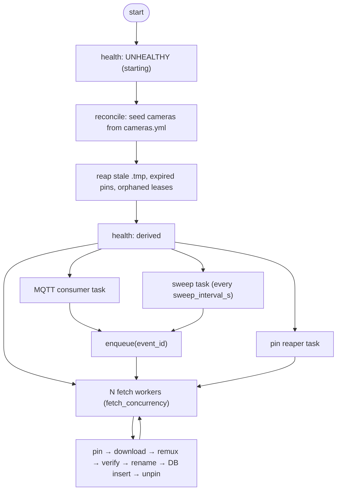

# LLD 02 — clip-worker

**Implements:** [INV-1](../invariants.md), [INV-5](../invariants.md), [INV-9](../invariants.md), [INV-12](../invariants.md), [INV-14](../invariants.md)
**Version:** 📐 draft

Turning a completed Frigate **review item** into exactly one canonical clip file. A
canonical clip is one *visit*, not one tracked object ([ADR-0016](../../adr/0016-clip-per-review-item.md)).
This is the component that creates the artefact the entire system exists to protect, and
the one with the tightest deadline: Frigate's own recording retention is a clock ticking
on every unmaterialised review.

---

## 1. Responsibilities

| # | Responsibility | Not |
|---|---|---|
| R1 | Consume `frigate/reviews` and decide what needs materialising | Decide retention |
| R2 | Pin an event in Frigate before downloading it | Upload anything |
| R3 | Download the clip, remux it, verify it | Delete anything |
| R4 | Write it atomically to the canonical path | Manage cloud storage |
| R5 | Compute and store `sha256`, size, duration | Serve clips |
| R6 | Release the pin once the clip is durable | Own Frigate's config |
| R7 | Sweep the Frigate API for events MQTT missed | Retry forever on a permanent error |
| R8 | Reap stale `.tmp` files and expired pins | |
| R9 | Report retention headroom as a health signal | |
| R10 | **Request a range wider than the event** (pre-roll before, post-roll after) and never fetch before Frigate has flushed the segments | Trim, or claim exact boundaries |
| R11 | **Measure what was obtained** — duration coverage, gaps, stream inventory — and persist it | Trust that the cut is right |
| R12 | Retry a short clip rather than accept or discard it, then keep the best result | Discard imperfect clips |

**R9 is not a nicety.** It is the only early warning that clips are about to be lost
irrecoverably. Everything else in this system fails safely; this fails finally.

**R10 and R11 exist because a bad clip is invisible.** A clip truncated by a flush race,
or one with a hole where a segment went missing, is a perfectly valid MP4: it plays, it
has a thumbnail, it uploads, and it passes every other check in this system. The only way
to catch it is to ask for more than you need and then measure what you got
([INV-14](../invariants.md)).

---

## 2. Main loop



### 2.1 Tasks

| Task | Count | Blocking? | Notes |
|---|---|---|---|
| HTTP server | 1 | no | `/health`, `/metrics`, `/admin/*` |
| MQTT consumer | 1 | no | Subscribes, parses, enqueues |
| Sweep | 1 | no | Periodic, resumable via the watermark |
| Fetch workers | `fetch_concurrency` (2) | **yes on purpose** | Bounded so Frigate's detection is not starved |
| Pin reaper | 1 | no | Releases pins held too long |
| Reaper | 1 | no | Startup + hourly `.tmp` cleanup |

Internal queue: an `asyncio.Queue` bounded at `2 × fetch_concurrency`. When full, the
producer **blocks** rather than dropping. Blocking back-pressures MQTT, whose broker
buffers. Dropping would silently lose clips — the one thing this component must not
do.

Each queue item carries a **`not_before` timestamp**, and a worker will not touch an item
before it is due:

```text
not_before = event.end_time + post_roll_s + segment_flush_grace_s
```

This is not throttling. It is a correctness requirement: Frigate writes recording segments
to cache and moves them to disk shortly afterwards, so fetching immediately after an event
ends can produce a **silently truncated clip**. Waiting for the flush is the difference
between a clip that ends where the action ends and one that ends wherever the disk
happened to be caught up. See [ADR-0015](../../adr/0015-clip-boundaries-and-padding.md).

The scheduler always takes the **earliest due** item, so a delayed item never blocks a
ready one.

---

## 3. Event intake

### 3.1 Trigger condition

Per the integration contract §3.4:

```python
should_materialise = (
    after.end_time is not None  # review is final
    and after.camera in known_cameras
    and after.severity in camera.clip.severities  # default [alert, detection]
    and any(o in camera.clip.objects for o in after.data.objects)
    and not db.exists(review_id=after.id)
)
```

Evaluated on **every** `frigate/reviews` message regardless of `type`. Frigate
publishes `update` messages as activity continues, and we must not depend on receiving a
final `end` message that a broker restart could have eaten.

**Why reviews and not events.** A single visitor produces several tracked objects and
therefore several events. Those are one visit — three overlapping clips containing the
same footage is not what anybody wants to watch ([ADR-0016](../../adr/0016-clip-per-review-item.md)).
Frigate already computes the grouping, so we consume it rather than inventing visit
windows. Events are still consumed, but only to record the constituent event ids in the
clip's sidecar.

### 3.2 The fetch range and schedule

Two values are computed at enqueue time and travel with the queue item:

```python
pre_roll_s = camera.clip.pre_roll_s  # default 5
post_roll_s = camera.clip.post_roll_s  # default 10

requested_start = review.start_time - pre_roll_s
requested_end = review.end_time + post_roll_s
not_before = review.end_time + post_roll_s + segment_flush_grace_s
```

| Value | Why it is what it is |
|---|---|
| `requested_start` before the review | Frigate's review begins when the object is first tracked, so the approach is already missing without pre-roll |
| `requested_end` after the review | The review ends when activity stops, which is usually before the subject has left frame |
| Asymmetric | Wanted in practice: post-roll longer than pre-roll. Symmetric padding would inflate every clip ([ADR-0015](../../adr/0015-clip-boundaries-and-padding.md)) |
| `not_before` | Waits for Frigate's segment flush, which is what prevents silent truncation. **Measured floor is 10 s** — see spike/RESULTS.md (in the repo root — removed from docs) |

Both rolls are per-camera overridable in `cameras.yml`, because a driveway where cars
manoeuvre wants a longer post-roll than a doorway.

> **Pre-roll is the least protected footage in the clip.** The event pin protects the
> *event*; segments *before* `start_time` may fall outside what Frigate considers
> retained. Keep pre-roll modest (the 5 s default) and heed the validation warning
> above 30 s.

### 3.3 Idempotency at intake

Three independent guards, because duplicates arrive constantly in normal operation — a
review is `update`d as activity continues:

1. **In-memory**: a `set` of recently-seen review ids (bounded, ~10 000 entries)
2. **Queue**: the fetch worker re-checks the DB before starting
3. **Database**: `UNIQUE(review_id)` on `clips` makes a duplicate insert an error the
   worker treats as "already done"

Guard 3 is the only one that matters for correctness. Guards 1 and 2 are for
efficiency.

### 3.4 Filtering

| Condition | Action |
|---|---|
| `end_time` is null | Skip. The review is still open — wait for it to finalise |
| `severity` not in `clip.severities` | Skip, log DEBUG. Per-camera policy |
| No object in `data.objects` matches `clip.objects` | Skip, log DEBUG. Default is `[person]` |
| Camera not in `cameras.yml` | Skip, log WARNING once per camera |
| Review already in DB | Skip silently |
| Camera `detect.enabled: false` | Still materialise if a review exists (`record.mode` may still produce one) |
| Review shorter than `min_clip_duration_s` (1.0) | Materialise anyway. Frigate found something; we are not a second judge |
| Review longer than `long_clip_warn_s` (1800) | Materialise **in full**, flag it, count it. Never split, never truncate |

---

## 4. Materialisation sequence

The ordering is the design. **Pin → download → verify → rename → record → unpin.**
Every intermediate crash leaves a recoverable state, never a lost clip.

### Step 1 — Pin

```http
POST /api/events/{event_id}/retain
```

| Outcome | Action |
|---|---|
| Success | Insert `pinned_events` row, state `held` |
| `404` | Event already pruned. Record `EXPIRED_BEFORE_FETCH`, `critical` audit event. **This is data loss** and must be counted, not swallowed |
| Auth error | Fatal for the pipeline: no point downloading. `UNHEALTHY`, alert |
| Network error | Retry with backoff; do not download without a pin |

> **Why not skip the pin and just download?** Because between deciding and
> downloading, Frigate's cleanup can expire the recordings the clip is cut from.
> The pin is the difference between "usually works" and "works".

**Pin budget.** `max_pinned_events` (500) bounds how much Frigate disk we can
withhold. Exceeding it is `DEGRADED` with an explicit message, because it means the
pipeline is not draining.

### Step 2 — Download

```http
GET /api/{camera}/start/{requested_start}/end/{requested_end}/clip.mp4
```

Wait until `not_before` before issuing this. The wait is the mechanism that avoids the
truncation race rather than retrying after losing it.

```python
tmp = clips_dir / camera / date / f".{basename}.tmp.{pid}-{rand}"
async with client.stream("GET", url, timeout=fetch_timeout_s) as r:
    if r.status_code == 400 and "No recordings found" in body:
        raise NoRecordingsYet()  # retryable: the flush has not happened, or footage expired
    r.raise_for_status()
    async with aiofiles.open(tmp, "wb") as f:
        async for chunk in r.aiter_bytes(64 * 1024):
            f.write(chunk)
            received += len(chunk)
    await f.flush()
    os.fsync(f.fileno())
```

| Check | Action on failure |
|---|---|
| `400` + `"No recordings found"` | **Retryable.** Wait `flush_retry_delay_s` and re-fetch, up to `max_flush_retries`. Usually the flush, occasionally expiry |
| HTTP status not 200 | Classify per the error matrix; a `404` triggers one fallback to the event endpoint with `padding = max(pre_roll, post_roll)` |
| `Content-Length` present and received ≠ it | Truncated → delete `.tmp`, retry |
| Zero bytes | Retry; after 3 attempts, permanent with a clear message |
| Timeout | Delete `.tmp`, retry with backoff |
| Disk full (`ENOSPC`) | **Stop the whole worker.** Free space is now `DISABLED`; alert `critical`. Do not hammer a full disk |

> **The range endpoint returns `400`, not `404`, when there is no footage.** Classifying
> that as a malformed request would turn every flush lag into a permanently lost clip.
> It is the single most important error-classification decision in this component.

### Step 3 — Remux (optional, default on)

The stream from Frigate is a **fragmented MP4** (`frag_keyframe+empty_moov`). That is
fine for streaming and poor for storage: many players, including several browser
players, handle it badly, and progressive download suffers because the moov atom is
not at the front.

```bash
ffmpeg -hide_banner -loglevel error -y \
  -i <tmp> -map 0 -c copy -movflags +faststart \
  -f mp4 <tmp>.remux
```

| Property | Value |
|---|---|
| Re-encode | **None.** `-c copy` — the video bits are untouched |
| Streams | `-map 0` maps **every** stream. We never pass `-an`. Audio is evidence and stripping it saves nothing meaningful |
| Cost | Roughly I/O-bound; ~50–200 ms for a 10 MB clip |
| Benefit | Plays in every client we care about; supports progressive download; suitable for a future browser-based clip browser |
| Disabled by | `clip_worker.remux: false` → we store Frigate's stream verbatim |
| Failure | **Non-fatal.** Log WARNING, use the original. A clip that plays badly beats no clip |

The original `.tmp` is deleted only after the remuxed file passes verification.

### Step 4 — Verify and measure

```bash
ffprobe -v error -show_entries \
  format=duration,size:stream=codec_type,codec_name -of json <file>

# gap detection; skipped (and recorded as skipped) for clips over gap_check_max_s
ffprobe -v error -select_streams v -show_packets \
  -show_entries packet=pts_time -of csv=p=0 <file>
```

```python
requested_s = requested_end - requested_start
actual_s    = format.duration
coverage    = actual_s / requested_s
max_gap_s   = max(delta between consecutive video packet pts_time)
has_audio   = any(stream.codec_type == "audio")
```

| Check | Result |
|---|---|
| `ffprobe` exits 0, duration > 0, size > `min_clip_bytes` | Otherwise → retry, then `FAILED_PERMANENT` |
| `coverage ≥ coverage_ok` (0.95) | Accept |
| `coverage_retry` (0.80) ≤ `coverage` < 0.95 | **Accept**, log `WARNING`, set `degraded`, and re-fetch once later in case a later attempt does better |
| `coverage < 0.80` | **Do not accept.** Wait `flush_retry_delay_s`, re-fetch, up to `max_flush_retries` (3) |
| Retries exhausted | **Accept the best result obtained**, set `degraded`, record `CLIP_COVERAGE_LOW`, alert |
| `max_gap_s` above threshold | Set `has_gaps`, record the largest gap, **keep the clip**, count it |
| Duration above `long_clip_warn_s` (1800) | Set `long_clip`, keep the **full** clip, log `WARNING` |

**A short clip is always kept.** Discarding it because a better one might arrive converts
degraded evidence into no evidence. Retrying improves the outcome; discarding cannot.

**A clip with gaps is never repaired.** The footage in the gap no longer exists anywhere —
re-fetching, re-encoding, and trimming cannot restore it. The clip is stored, flagged, and
reported, so the operator learns the recording is incomplete instead of believing it is
whole.

**Long clips are never truncated.** A duration cap would be data loss with a tidier name.

**Coverage cannot distinguish "we truncated it" from "Frigate never had it".** Both look
like a short clip, and that is acceptable because the response is identical either way —
retry, then keep and flag. The alternative would be to guess.

A clip that fails the structural checks (unplayable, zero duration, unreadable) after
`max_fetch_attempts` is recorded as `FAILED_PERMANENT` for **materialisation** — a state
separate from upload — kept as a `.tmp.bad` file for diagnosis, and alerted. An operator
may still recover it from Frigate, and the retained pin is exactly what preserves that
window.

### Step 5 — Atomic rename

```python
final = clips_dir / camera / "YYYY" / "MM" / "DD" / "HH-MM-SS.mp4"
final.parent.mkdir(parents=True, exist_ok=True)
os.rename(verified_file, final)  # atomic: same filesystem
fsync_dir(final.parent)  # make the rename durable
```

Same filesystem is guaranteed by the installer's single-filesystem check
([`on-disk-layout.md`](../contracts/on-disk-layout.md#5-filesystem-requirements)).

**Collision handling.** If `final` already exists:

| Situation | Action |
|---|---|
| Existing row has the same `event_id` | Already done — discard the new file, log DEBUG |
| Existing row has a different `event_id` | Append `-<last 6 of event id>` to the basename, deterministically. Log INFO |

Never overwrite. Never randomise.

### Step 6 — Hash and record

```python
sha256 = hash_file(final)  # streamed, never loads the file into memory
size = final.stat().st_size
```

Single `BEGIN IMMEDIATE` transaction:

```sql
INSERT INTO clips (event_id, camera, label, zones, start_time, end_time, duration_s,
                   requested_start_ts, requested_end_ts, requested_s, coverage_ratio,
                   pre_roll_s, post_roll_s, max_gap_s, has_gaps, has_audio,
                   video_codec, audio_codec, fetch_attempts, degraded, long_clip,
                   path, size_bytes, sha256, upload_state, materialised_at, created_at,
                   updated_at, pinned, pinned_at)
VALUES (..., 'PENDING', ...);
```

The requested range, the achieved duration, the coverage ratio, the largest gap, and the
fetch-attempt count are all persisted. They are what makes [INV-14](../invariants.md)
auditable after the fact, and they turn "are the clips right?" into a query — see
[`database-schema.md`](../contracts/database-schema.md#23-clips-the-central-table).

`upload_state = 'PENDING'` is what hands the clip to the uploader. A `SKIPPED_BY_POLICY`
insert is used instead when the camera has `retention.upload: false`.

If the insert fails on the unique constraint, another worker won the race: discard our
file, log DEBUG. Racing is rare (the DB check happens first) but must be correct.

### Step 7 — Write the sidecar

```json
{
  "schema_version": 1,
  "event": { /* the frigate/events `after` payload, verbatim */ },
  "clip": {
    "camera": "front-door",
    "event_id": "1734567890.123456-abcxyz",
    "path": "front-door/2026/09/11/18-32-45.mp4",
    "start_time": 1734567890.123456,
    "requested_start": 1757590360.12,
    "requested_end": 1757590395.65,
    "requested_s": 35.53,
    "actual_s": 35.2,
    "coverage_ratio": 0.991,
    "pre_roll_s": 5.0,
    "post_roll_s": 10.0,
    "max_gap_s": 0.0,
    "has_gaps": false,
    "has_audio": true,
    "video_codec": "h264",
    "audio_codec": "aac",
    "fetch_attempts": 1,
    "degraded": false,
    "long_clip": false,
    "size_bytes": 7864320,
    "sha256": "…",
    "materialised_at": 1734567950.1,
    "remuxed": true,
    "cctv_version": "1.0.0"
  }
}
```

Written **after** the clip, atomically. A crash between them leaves a clip without a
sidecar — recoverable, and the DB is authoritative anyway. The reverse order would
leave metadata for a file that does not exist, which is a lie.

The sidecar stores the **entire** event payload verbatim. This is what makes "we
ignore field X" safe: nothing Frigate told us is discarded, so a future version can
read fields the current one never looked at.

### Step 8 — Unpin

```http
DELETE /api/events/{event_id}/retain
```

| Outcome | Action |
|---|---|
| Success | `pinned_events.state = 'released'` |
| Failure | Log WARNING; leave the row `held`. The pin reaper will retry |

Failure here is non-fatal and costs only Frigate disk. The pin reaper (§6) exists so
that a persistently failing unpin cannot fill the disk.

### 4.1 Failure state summary

```text
PIN_FAILED            → no clip produced; alert; retried, then FAILED_PERMANENT(materialise)
NO_RECORDINGS_YET     → 400 from Frigate; retryable; flush lag or expired footage
FETCH_FAILED          → retried up to 3, then FAILED_PERMANENT(materialise)
VERIFY_FAILED         → retried up to 3, then FAILED_PERMANENT(materialise), .bad kept
COVERAGE_LOW_ACCEPTED → best result kept, degraded=1, alerted, NEVER discarded
GAPS_FOUND            → clip kept, has_gaps=1, counted, NEVER repaired
LONG_CLIP             → stored in full, flagged, counted, NEVER truncated
EXPIRED_BEFORE_FETCH  → permanent, counted as DATA LOSS, alerted critical
DISK_FULL             → pipeline disabled until space is freed
```

Materialisation state is tracked separately from `upload_state` in the `clips` table
or, pre-insert, in a small `materialisation_attempts` side table. Keeping them
separate is essential: a clip can be `FAILED_PERMANENT` at materialisation (no file)
and must never appear in the upload queue.

---

## 5. Reconciliation sweep

```text
every sweep_interval_s:
  cursor = watermark − sweep_overlap_s
  loop:
      events = GET /api/events?has_clip=1&in_progress=0&after=cursor
                         &limit=sweep_page_size&sort=date_asc
      if events is empty: break
      for e in events:
          if not exists(e.id): enqueue materialisation
          track max(event.start_time)
      cursor = max(event.start_time) + epsilon
      if len(events) < page_size: break

  on FULL success:
      watermark = max_processed_start_time     ← advance only here, in one transaction
      last_success_at = now; consecutive_failures = 0
  on ANY failure:
      leave watermark untouched; consecutive_failures += 1; retry next tick
```

| Property | Why |
|---|---|
| Watermark advances only on complete success | Crash-safe by redoing, never by skipping |
| Overlap window | Tolerates clock skew and events whose `end_time` is well after `start_time` |
| Ascending sort | Bounded memory; the watermark is monotonic |
| Failure does not advance | The next run redoes the batch; dedupe makes it cheap |

### 5.1 What the sweep does not do

- It does not unpin or repair. It only enqueues.
- It does not read the filesystem. Events with a DB row are skipped even if the file
  is missing — that case belongs to the reconciliation job in
  [`lld/05`](05-cleanup.md).
- It does not trust `has_clip` alone; if an event has `has_clip: true` but Frigate has no
  footage for the range, the fetch is retried and then recorded as
  `EXPIRED_BEFORE_FETCH`, and it is counted. Note that the range endpoint signals this
  with **`400`**, not `404` — and the sweep must not conflate the two, because the `400`
  is usually transient flush lag rather than expiry.

---

## 6. Reapers

| Reaper | Interval | Action |
|---|---|---|
| `.tmp` reaper | startup + hourly | Delete `.*.tmp.*` older than 24 h. Never touches a `.tmp` younger than that, because a slow download may still own it |
| `.bad` reaper | daily | Delete `*.bad` older than 7 days; keep the row for the audit trail |
| Pin reaper | 60 s | For pins held longer than `pin_timeout_h`, call `unretain`, mark `expired`, emit WARNING. If more than 50 pins expire in one run, emit `critical` — that means materialisation is broken |
| Empty directory reaper | daily | Remove empty `YYYY/MM/DD` directories left behind by retention |

---

## 7. Health checks

| Check | HEALTHY | DEGRADED | UNHEALTHY |
|---|---|---|---|
| `state_db` | read/write ok | — | cannot query |
| `frigate_api` | reachable, authed | — | unreachable or `401` |
| `mqtt` | connected | reconnecting < 5 periods | disconnected, or sweep failing too |
| `clips_dir_writable` | write test passes | — | fails |
| `retention_headroom` | > 6 h for every unmaterialised event | < 6 h | < 1 h, or any event already expired |
| `sweep_lag` | watermark < 1 h behind | 1–6 h behind | > `max_backlog_s` (6 h) |
| `pins_held` | < 50 % of budget | 50–90 % of budget | > 90 % of budget |
| `clip_quality` | < 1 % of last 24 h below `coverage_ok` | 1–5 % | > 5 %, or any `coverage < 0.5` |
| `clip_gaps` | 0 clips with gaps in 24 h | 1–10 | > 10, or one camera responsible for most |
| `flush_pressure` | mean `fetch_attempts` ≤ 1.2 | 1.2–2.0 | > 2.0 |

`clip_quality` and `flush_pressure` are the two signals that catch a silently degrading
clip pipeline. Both describe clips that **played fine, uploaded fine, and passed every
other check** — see [INV-14](../invariants.md). A rising `flush_pressure` mean means
`segment_flush_grace_s` is too short for this host.

### 7.1 Retention headroom — the numbers

```text
oldest_unmaterialised_start = MIN(start_time) over events pending materialisation
source_expires_at           = oldest_unmaterialised_start + frigate_record_retention
headroom_s                  = source_expires_at − now
```

The **fetch deadline** is later than the event end, because of post-roll and the flush
grace:

```text
fetch_not_before = event.end_time + post_roll_s + segment_flush_grace_s
```

So the usable recovery window is `source_expires_at − fetch_not_before`, which is a few
seconds shorter than the naive calculation suggests. Headroom uses the fetch deadline,
not the event end, so it does not overstate the margin.

Health thresholds: `≥ 21600 s` healthy, `≥ 3600 s` degraded, `< 3600 s` unhealthy.

Surfaced in `/health` as:

```json
{ "name": "retention_headroom", "state": "DEGRADED", "code": "RETENTION_HEADROOM_LOW",
  "detail": "oldest unmaterialised event started 71h ago; Frigate recordings expire in 1h 12m",
  "latency_ms": null }
```

The severity comes from the consequence: once headroom reaches zero, the clip cannot
be recovered by **any** later action. Every other failure in this system can be fixed
by fixing the cause.

---

## 8. Concurrency and resource limits

| Limit | Default | Rationale |
|---|---|---|
| `fetch_concurrency` | 2 | We are a guest on Frigate's CPU. Each concurrent fetch runs an ffmpeg cut |
| Queue depth | 4 | Back-pressure rather than unbounded memory |
| `fetch_timeout_s` | 120 | A 25 s clip should cut in well under a minute; 120 s is generous |
| Max in-flight pins | 500 | Bounds how much Frigate disk we withhold |
| DB transactions | Short, never spanning I/O | Per the DB contract |

**Why so conservative?** Because the failure mode of being greedy is worse than the
failure mode of being slow. Overloading Frigate raises its detection latency, which
degrades detection quality on the live system. Being slow only delays our copy, and
we have a 72-hour window to be slow in — as long as headroom health is honest about
it.

### 8.1 Back-pressure ladder

```text
queue full              → MQTT consumer blocks → broker buffers → nothing lost
headroom shrinking      → health DEGRADED → alert → operator looks
headroom near zero      → health UNHEALTHY → alert critical → operator acts
headroom exhausted      → data loss, recorded in EXPIRED_BEFORE_FETCH, counted forever
```

---

## 9. Configuration

| Key | Default | Effect |
|---|---|---|
| `pre_roll_s` | 5.0 | Footage included before `event.start_time`. Per-camera overridable |
| `post_roll_s` | 10.0 | Footage included after `event.end_time`. Per-camera overridable |
| `segment_flush_grace_s` | **15** | Wait after the roll before fetching, so Frigate has flushed the final segment. **Measured floor is 10 s** — see spike/RESULTS.md (in the repo root — removed from docs). Raise this first if `flush_pressure` is high |
| `max_flush_retries` | 3 | Re-fetch attempts when coverage is below `coverage_retry` |
| `flush_retry_delay_s` | 15 | Delay between re-fetches |
| `coverage_ok` | 0.95 | Accept at or above this ratio |

> ⚠️ **`max_gap_s` needs a different criterion before it ships.** M1 measured a **3.55 s**
> packet gap in a healthy 30-second clip whose keyframe interval was only **2.55 s**.
> Two possible explanations: the camera genuinely dropped frames, or `-c copy`
> concatenation of recording segments produces **timestamp discontinuities at segment
> joins**. The second is more likely and is a fatal problem for the naive measure —
> essentially every clip would be flagged as holed, and a signal that fires always
> carries no information.
>
> Candidates, in preference order:
>
> 1. **Detect gaps against Frigate's `recordings` table** rather than packet timestamps:
>    a missing segment is a known fact, not an inference from a PTS delta.
> 2. **Compare the clip's duration against the sum of the overlapping segments' durations.**
>    Concatenation preserves total duration; a hole reduces it.
> 3. Keep packet-delta detection but **subtract known segment boundaries** before
>    measuring, so joins are not counted.
>
> Until one of these is implemented, `max_gap_s` must be treated as **advisory only**,
> and no health signal may depend on it. See [ADR-0015](../../adr/0015-clip-boundaries-and-padding.md).
| `coverage_retry` | 0.80 | Below this, do not accept — retry |
| `max_gap_s` | 2.0 ⚠️ | Video packet delta above this counts as a hole. **Not yet trustworthy** — see the warning below |
| `gap_check_max_s` | 300 | Above this duration, sample packets rather than scanning |
| `long_clip_warn_s` | 1800 | Flag long clips. They are stored in full regardless |
| `trim_to_range` | `false` | Opt-in trimming. **Can only remove footage, never restore it** |
| `fetch_concurrency` | 2 | Parallel downloads |
| `fetch_timeout_s` | 120 | Per-download timeout |
| `max_fetch_attempts` | 3 | Structural failures before `FAILED_PERMANENT` |
| `remux` | `true` | `-map 0 -c copy -movflags +faststart` |
| `min_clip_bytes` | 1024 | Sanity floor |
| `sweep_interval_s` | 300 | Reconciliation cadence |
| `sweep_page_size` | 100 | API pagination |
| `sweep_overlap_s` | 600 | Watermark safety margin |
| `max_backlog_s` | 21600 | `UNHEALTHY` sweep lag |
| `max_pinned_events` | 500 | Pin budget |
| `pin_timeout_h` | 6 | Reaper threshold |
| `headroom_warn_s` / `headroom_critical_s` | 21600 / 3600 | Health thresholds |
| `min_clip_duration_s` | 1.0 | Below this, still materialise but log INFO |

---

## 10. Tests

| Test | Asserts |
|---|---|
| Happy path | Fixture MQTT event → correct path, correct hash, `PENDING` row, pin released |
| Pin ordering | A crash after pin but before download leaves the pin held and the event recoverable |
| Download truncation | A short stream is detected, `.tmp` removed, retried |
| Remux safety | A remux failure stores the original and logs WARNING (no clip lost) |
| Atomicity | `kill -9` between rename and DB insert → the reaper and the sweep converge without duplication |
| Idempotency | Delivering the same event 5 times produces 1 file and 1 row |
| Collision | Two events in the same camera-second produce two distinct deterministic paths |
| Sweep resumption | A crash mid-sweep does not advance the watermark; the next sweep completes it |
| Sweep overlap | Events ending long after their start time are still found |
| EXPIRED_BEFORE_FETCH | Simulated Frigate expiry is counted as data loss and alerted, not swallowed |
| Unknown camera | Dropped with a WARNING, no crash, no retry loop |
| Unknown MQTT field | Parser tolerates it |
| Back-pressure | With the queue full, no event is dropped |
| Disk full | `ENOSPC` disables the pipeline and alerts; no retry storm |
| Headroom health | Compressed Frigate retention raises `UNHEALTHY` before the first loss |
| Pin reaper | 600 held pins are released and the disk-pressure alert fires |
| DST | Events either side of a fallback hour produce distinct, correctly-named paths |
| **Boundary — pre-roll** | Synthetic source with a per-second colour code: the first decoded frame falls within tolerance of `event.start_time − pre_roll_s` |
| **Boundary — post-roll** | The last decoded frame falls within tolerance of `event.end_time + post_roll_s` |
| **Boundary — asymmetric** | `pre_roll_s: 5, post_roll_s: 20` produces a clip covering roughly that range, with no 20 s lead-in |
| **Boundary — erring outward** | Achieved duration ≥ requested duration, or within the keyframe tolerance; the clip never comes back shorter than requested when the footage exists |
| **Flush race** | With `segment_flush_grace_s: 0`, truncation is reproduced; with the default, it is not — proving the schedule is what prevents it |
| **Coverage retry** | A first fetch that returns 60 % coverage triggers a delayed re-fetch; the better result is the one stored |
| **Coverage never discards** | With Frigate permanently returning short clips, the best result is stored, `degraded=1`, and **no clip is lost** |
| **`400` is retryable** | `400 "No recordings found"` triggers a retry, not a permanent failure |
| **Gap detection** | A synthetic clip with a removed middle segment reports `has_gaps`, a plausible `max_gap_s`, and is **stored**, not discarded |
| **Audio preserved** | A source with an audio track produces a clip with an audio track, and the codec is recorded |
| **Long clip** | A 2-hour event is stored in full and flagged `long_clip`, never truncated |
| **Trim opt-in** | With `trim_to_range: true`, trimming only ever shortens within keyframe tolerance and never extends |
| **Overlap of pins and rolls** | A held pin plus a deferred fetch keeps every segment available for the whole wait |
