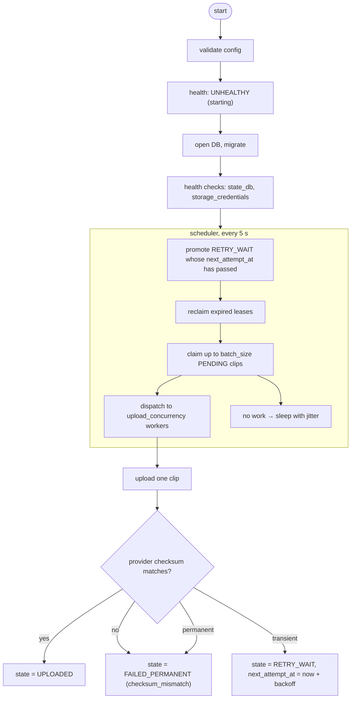

# LLD 04 — uploader

**Implements:** [INV-1](../invariants.md), [INV-7](../invariants.md), [INV-10](../invariants.md)
**Specified by:** [`contracts/database-schema.md`](../contracts/database-schema.md), [`contracts/cloud-object-layout.md`](../contracts/cloud-object-layout.md)

---

## 0. Implementation status

**Built** (M3, `0.3.0`): `src/cctv/uploader.py` (the service and the claim/upload/record
loop), `src/cctv/storage.py` (the adapter and the error classification), `src/cctv/health.py`
(the health contract and its HTTP surface). Entry point `cctv-uploader`; an `uploader`
service in `compose.yml` with `clips/` mounted **read-only**; 136 new tests across
`tests/test_uploader.py` (62), `tests/test_storage.py` (38) and `tests/test_health.py` (36),
plus 10 more for the new state-store accessors in `tests/test_db.py`. The suite is 656.

Verified by running it: the service starts against a throwaway site, migrates a fresh
database, reports `DISABLED` with no bucket configured, serves `/health` and `/metrics`,
refuses `/admin/queue` without a token, and shuts down cleanly on `SIGTERM`. The real
`boto3` client and the multipart `TransferConfig` are constructed with every argument this
document specifies. Everything else is verified against a fake S3 client and a throwaway
`sqlite3` database, not against Backblaze.

Where this document and the code disagreed, the code followed the document except in these
four places. Each is a decision, and each is recorded here rather than left for a reader to
discover:

| This document | What was built | Why |
|---|---|---|
| §4 lists `throttled`, `file_missing` and `invalid_request` alongside the rest | Mapped onto the six classes `clips.last_error_class` accepts | The column has a closed `CHECK` (database-schema §2.3). A seventh value would mean a table rebuild for a label, and the *decision that matters* — retry or not — is carried by `StorageError.retryable`. The message and the audit event name the specific cause |
| §3 step 6 emits `system_events` on every success | One log line per upload plus the `upload_attempts` row; no per-success audit row | `system_events` is also the alert-deduplication store. ~100 success rows a day would be an audit trail whose signal is buried, and nothing alerts on success |
| §6 measures `oldest_pending_age_s` from the clip's event | Measured from `COALESCE(materialised_at, created_at)` | A clip materialised an hour after its event is not an hour behind on *upload*. The number has to mean "how long has this been waiting to be uploaded" or it is not actionable |
| §9 `/admin/verify` | **Not implemented** | It re-downloads a whole object, and downloads are the one thing B2 bills for. Nothing in M3's exit criteria needs it. `aws s3api head-object` answers the same question for free, because every object carries its own `sha256` in its metadata. Tracked in plans/backlog.md (moved to `.private/plans/`) |

The checks this service reports are the six §8 requires plus `failed_permanent` and
`upload_verification`: `state_db`, `storage_reachable`, `storage_credentials`,
`local_files_readable`, `upload_staleness`, `backlog_age`, `failed_permanent`,
`upload_verification`.

Getting every canonical clip into Backblaze B2 exactly once, surviving restarts,
network partitions, credential rotations, and provider outages — and never, under any
circumstance, becoming the reason a clip is lost.

---

## 1. Responsibilities

| # | Responsibility | Not |
|---|---|---|
| R1 | Claim `PENDING` clips atomically | Decide retention |
| R2 | Derive the cloud key deterministically | Delete local files |
| R3 | Upload through the storage adapter | Touch Frigate |
| R4 | Verify the provider checksum before recording success | Rematerialise clips |
| R5 | Classify failures and retry with backoff | Repair broken files |
| R6 | Surface backlog age, staleness, and permanent failures as health | |
| R7 | Reclaim expired leases | |
| R8 | Provide `retry` and `queue` admin endpoints | |

**What the uploader must never do:** delete, move, rename, or modify a file under
`data/clips/`. It mounts that directory **read-only**
([`on-disk-layout.md`](../contracts/on-disk-layout.md#4-mount-map)). The mount flag is
the enforcement; the rule is the intent. A bug that unlinks the only local copy of an
un-uploaded clip would violate [INV-1](../invariants.md) at the most damaging possible
moment.

---

## 2. Main loop



### 2.1 Scheduling

| Parameter | Default | Notes |
|---|---|---|
| Scheduler tick | 5 s | Cheap: two UPDATEs and one SELECT |
| `batch_size` | 20 | Clips claimed per tick |
| `upload_concurrency` | 4 | Parallel uploads |
| Idle sleep | 5 s + jitter ±20 % | Jitter avoids lock-step retries across containers after a restart |
| Lease | 900 s | Long enough for a slow large-clip upload; short enough that a crash recovers in 15 min |

**Why a fixed tick rather than event-driven wakeups:** simplicity and observability.
A 5-second tick at our volumes (a few hundred uploads a day) is nothing, and it means
the loop is fully described by "look at the database, do the work that is due". Event
notifications would add a code path that can be missed.

---

## 3. Upload sequence

### Step 1 — Claim

Per the DB contract §3.3. Increments `attempts` and sets a lease. No network I/O
inside the transaction.

### Step 2 — Pre-flight

| Check | On failure |
|---|---|
| Local file exists | `FAILED_PERMANENT`, `file_missing`. `CRITICAL` audit event — the DB says a clip exists and it does not. This is a real inconsistency and must be loud |
| File size matches `size_bytes` | If different, re-hash. If the hash differs, `FAILED_PERMANENT` `checksum_mismatch` |
| File readable | `transient` → retry (a transient mount or permission blip) |
| Re-hash if `sha256` is null or the file changed | Recompute and update, then continue |

### Step 3 — Derive the key

```python
key = f"{location}/clips/{clip.path}"  # clip.path is relative to data/clips/
```

No translation, no escaping, no platform-specific handling. The contract requires
key equality with the local path precisely so that this line is trivial and testable.

A test asserts this equality for every clip row.

### Step 4 — Upload

```python
result = adapter.put_object(
    key=key,
    path=abs_path,
    metadata=metadata_for(clip),  # per cloud-object-layout §3.2
    checksum_sha256=clip.sha256,
)
```

| Behaviour | Detail |
|---|---|
| Idempotent | Re-uploading identical bytes to the same key is a success, not an error |
| Overwrite | Only permitted when the existing object's content is identical. An existing object with **different** content is a `critical` condition, never silently replaced |
| Single-part | Below `multipart_threshold_bytes` (100 MB) |
| Multipart | Above it. Changes checksum semantics — see the contract §4.2 |
| Streaming | The file is streamed from disk; never loaded into memory |
| Timeout | `upload_timeout_s` (default 600 s for large files) |

### Step 5 — Verify

Only after a positive verification is the row marked `UPLOADED`.

| Verification available | Action |
|---|---|
| Comparable provider checksum | Compare to `sha256`. Mismatch → `FAILED_PERMANENT` `checksum_mismatch` |
| No comparable checksum (multipart) | Fall back to a `HEAD`: compare size and our recorded metadata (`sha256` in object metadata). Record the verification method used |
| Neither available | Do not claim verified. Mark `UPLOADED` with a `verified_by: none` note and raise `DEGRADED` — an unverified backup is not a backup |

> **Rule:** never claim a verification we did not perform. Marking a clip `UPLOADED`
> tells cleanup it is safe to delete the local copy. A false `UPLOADED` is the direct
> cause of permanent data loss, so this is the one place where a conservative,
> slightly pessimistic answer is always correct.

### Step 6 — Record

```sql
UPDATE clips
   SET upload_state = 'UPLOADED',
       uploaded_at = :now,
       cloud_key = :key,
       cloud_etag = :etag,
       cloud_size_bytes = :size,
       lease_owner = NULL,
       lease_expires_at = NULL,
       last_error = NULL,
       last_error_class = NULL,
       updated_at = :now
 WHERE id = :clip_id;
```

Plus an `upload_attempts` row with `outcome='success'`.

**Crash between step 4 and step 6** is the scenario [INV-7](../invariants.md) exists
for. On restart the lease expires, the row returns to `PENDING`, and the upload runs
again. Because the key is deterministic and the bytes are identical, the second PUT is
a no-op overwrite with the same content. The result is one object, and the state
converges to `UPLOADED`.

This is tested explicitly with a crash injected at exactly that point.

---

## 4. Error classification

The classification determines everything: whether we retry, how long, and how loudly
we alert. Getting it wrong is how you either hammer a dead endpoint forever or give up
on a five-second network blip.

| Class | Detected by | Retry | Backoff ceiling | Alert |
|---|---|---|---|---|
| `transient` | `5xx`, connection reset, DNS failure, timeout | ✅ indefinite | 1 h | `DEGRADED` after `stale_upload_warn_s` |
| `throttled` | `429`, provider rate-limit code | ✅ indefinite | 1 h, longer floor | `DEGRADED` if sustained > 1 h |
| `auth` | `401`, `403` | ❌ | — | **`UNHEALTHY`, `critical`, immediate** |
| `not_found` | `404` on the bucket | ❌ | — | **`critical`, immediate**, message names the expected bucket |
| `quota` | provider cap / payment error | ✅ | 6 h | **`critical`**, "operator action required" |
| `checksum_mismatch` | verification failed | ❌ | — | **`critical`**, local file preserved |
| `file_missing` | local file absent | ❌ | — | **`critical`**, consistency violation |
| `invalid_request` | `400` | ❌ | — | **`critical`** — our bug or a config error |
| `unknown` | anything else | ✅ (conservative) | 1 h | `WARNING`, then `DEGRADED` |

### 4.1 Why `auth` and `not_found` do not retry

Because they cannot succeed, and retrying them produces:
- thousands of failed requests and log lines that bury the real signal
- a health state that looks like "busy" rather than "broken"
- pointless API traffic against a provider that is already telling us no

Fast-failing loudly is the correct behaviour. The runbook
(`runbooks/rotate-credentials.md`) is the fix.

### 4.2 Why `unknown` retries

Because the cost of retrying something that turns out to be permanent is a bounded
number of attempts and some noise; the cost of not retrying something transient is a
permanently un-uploaded clip. Asymmetric costs mean the conservative default is to
retry.

---

## 5. Backoff

```python
delay = min(backoff_base * (2 ** (attempt - 1)), backoff_max)
delay = delay * random.uniform(0.8, 1.2)  # jitter
```

| Attempt | Delay (base 15 s) | Cumulative |
|---|---|---|
| 1 | ~15 s | 15 s |
| 2 | ~30 s | 45 s |
| 3 | ~1 m | ~2 m |
| 4 | ~2 m | ~4 m |
| 5 | ~4 m | ~8 m |
| 6 | ~8 m | ~16 m |
| 7 | ~16 m | ~32 m |
| 8 | ~32 m | ~64 m |
| 9 | ~1 h (capped) | ~2 h |
| 10–12 | ~1 h each | ~5 h |

**Jitter is not optional.** Without it, a provider outage that affects 200 clips
produces 200 synchronised retries every 15 s — a self-inflicted thundering herd
against an endpoint that just told us it is unwell.

### 5.1 Attempt ceiling

`max_attempts` (default 12) then `FAILED_PERMANENT`.

Roughly five hours of retrying. That is a deliberate number: long enough to ride out a
provider incident or an evening's internet outage (the common cases), short enough that
a genuinely broken configuration surfaces the next morning rather than the next week.

**A `FAILED_PERMANENT` clip is not lost.** The local file is retained
([INV-1](../invariants.md)), an alert is raised, and
[`runbooks/recover-failed-uploads.md`](../../runbooks/recover-failed-uploads.md) is the fix. The
worst outcome of reaching that state is a growing local backlog and a clear alert.

---

## 6. Backlog age — the metric that matters

`oldest_pending_age_s` is the single most useful number this service produces.

| Value | Meaning | Health |
|---|---|---|
| < 5 min | Normal | `HEALTHY` |
| 5 min – 30 min | Working through a backlog | `HEALTHY` |
| 30 min – 6 h | Something is wrong | `DEGRADED`, `BACKLOG_AGING` |
| 6 h – 24 h | Serious; investigate now | `DEGRADED`, alert |
| > 24 h, or any `FAILED_PERMANENT` | Data is at risk | `UNHEALTHY`, alert |

Why it matters more than "is the uploader running": a running uploader with a
six-hour-old backlog is not working. A stopped uploader with an empty queue is a
monitoring problem, not a data problem. Backlog age distinguishes these; process
liveness does not.

The complementary metric is `upload_staleness` — time since the last *successful*
upload. It catches the case where the queue is empty because nothing has arrived,
versus empty because nothing is getting through.

---

## 7. Concurrency

| Concern | Approach |
|---|---|
| Parallel uploads | `upload_concurrency` (4) async tasks |
| Claiming | Atomic; two workers cannot claim the same row |
| Provider rate limits | Backoff per clip; a `throttled` classification also applies a short global pause |
| Memory | Files are streamed; a 50 MB clip does not allocate 50 MB |
| Large files | Multipart with bounded part size |

### 7.1 Global pause on throttling

When a provider returns a rate-limit signal, *all* workers pause briefly rather than
each independently backing off. Otherwise four workers each politely retrying still
adds up to an impolite total.

Implementation: a shared `asyncio.Event` that workers await before uploading; the
scheduler clears it for a short window when a throttle is observed.

---

## 8. Health checks

| Check | HEALTHY | DEGRADED | UNHEALTHY |
|---|---|---|---|
| `state_db` | ok | — | cannot query |
| `storage_reachable` | `HEAD` on the bucket succeeds | latency > 5 s | fails |
| `storage_credentials` | accepted | — | `401`/`403` |
| `local_files_readable` | all pending paths readable | — | any missing → `file_missing` |
| `upload_staleness` | < 30 min | 30 min – 6 h | > 6 h with a non-empty queue |
| `backlog_age` | < 30 min | 30 min – 6 h | > 6 h (or > 24 h) |
| `failed_permanent` | 0 | — | ≥ 1 |

`/health` detail example:

```json
{ "name": "backlog_age", "state": "DEGRADED", "code": "BACKLOG_AGING",
  "detail": "3 pending, oldest 42m; 214 uploaded in the last 24h; 0 failed",
  "latency_ms": null }
```

---

## 9. Admin endpoints

Per [`service-contracts.md`](../contracts/service-contracts.md#4-admin-endpoints).
Internal network plus `INTERNAL_API_TOKEN`.

| Endpoint | Body | Behaviour |
|---|---|---|
| `GET /admin/queue` | — | Counts by state, oldest 20 pending, all `FAILED_PERMANENT` with their error class |
| `POST /admin/retry` | `{camera?, since?, clip_id?, reason}` | `FAILED_PERMANENT` → `PENDING`, `attempts` reset to 0, `reason` audited |
| `POST /admin/verify` | `{clip_id}` | Re-download and re-hash against `sha256` |

`reason` is mandatory and written to `system_events`. An audit trail of "why did
someone retry 400 uploads" is worth the one required field.

---

## 10. Configuration

| Key | Default | Effect |
|---|---|---|
| `scheduler_tick_s` | 5 | Loop cadence |
| `batch_size` | 20 | Clips claimed per tick |
| `upload_concurrency` | 4 | Parallel uploads |
| `lease_seconds` | 900 | Crash-recovery window |
| `max_attempts` | 12 | Before `FAILED_PERMANENT` |
| `backoff_base_s` | 15 | First retry delay |
| `backoff_max_s` | 3600 | Delay ceiling |
| `upload_timeout_s` | 600 | Per-upload timeout |
| `multipart_threshold_bytes` | 104857600 | Single-part vs multipart |
| `stale_upload_warn_s` | 1800 | `STORAGE_STALE` threshold |
| `backlog_warn_s` / `backlog_critical_s` | 1800 / 21600 | `BACKLOG_AGING` thresholds |
| `throttle_pause_s` | 30 | Global pause on rate limiting |

---

## 11. Tests

| Test | Asserts |
|---|---|
| Happy path | Clip → object at the expected key, checksum verified, `UPLOADED` |
| Crash after PUT, before state | Lease expires, re-upload is a no-op, exactly one object ([INV-7](../invariants.md)) |
| Idempotent re-upload | Three identical uploads → one object, same checksum |
| Key equality | Object key == `<location>/clips/` + relative path, for every row |
| Checksum mismatch | Permanent failure, local file preserved, `critical` alert, no retry |
| Auth failure | No retry, `UNHEALTHY`, immediate alert, no log storm |
| Bucket missing | No retry, `critical`, message names the bucket |
| Transient 503 | Retries with growing, jittered delays; succeeds when the endpoint recovers |
| Jitter | 200 concurrent failures do not produce synchronised retry timestamps |
| Attempt ceiling | `FAILED_PERMANENT` after `max_attempts`, alert raised, file retained |
| Backlog age | Oldest-first ordering; `backlog_age` health transitions at the thresholds |
| Storage down | Running for hours with B2 unreachable, then recovering: nothing lost, nothing duplicated |
| Startup with a backlog | A restart mid-backlog resumes without re-uploading completed clips |
| Concurrency | 8 workers, 500 clips → each uploaded exactly once |
| File missing | `FAILED_PERMANENT` `file_missing` with a `CRITICAL` audit event |
| Overwrite protection | An existing object with different content is never silently replaced |
| Read-only mount | The uploader cannot delete a clip even if the code tries |
