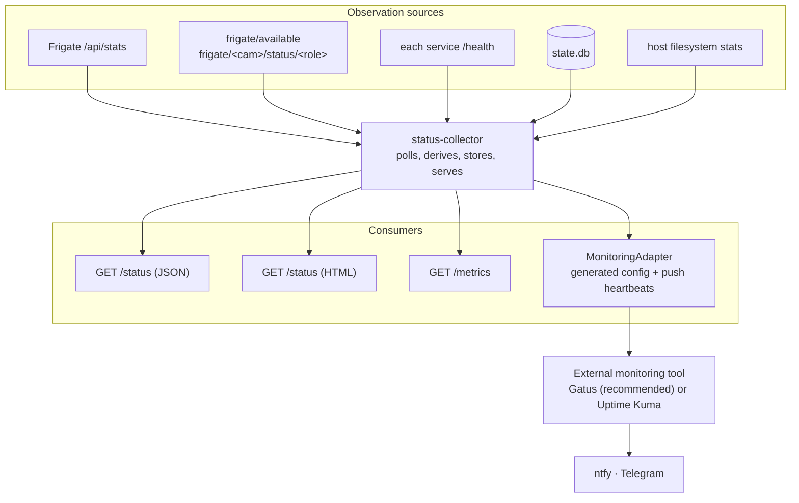

# LLD 06 — health and monitoring

**Implements:** [INV-6](../invariants.md)
**Specified by:** [`contracts/service-contracts.md`](../contracts/service-contracts.md)

> **Implementation status (2026-10-18).** Built: `src/cctv/status.py` (derivation, the answer
> string, camera states, storage projection) and `src/cctv/status_service.py` (`cctv-status`,
> schema `0003` for disk samples); then `src/cctv/monitoring.py` — the `MonitoringAdapter`, the
> `GatusAdapter`, the monitor inventory and push heartbeats. §3, §4, §5, §6.3–§6.5 and §7 are
> implemented; §2 is implemented as *polling* rather than MQTT subscription — camera state is
> read from Frigate's `/api/stats`, the same signal its MQTT status is derived from, so there is
> one source of truth and no second subscription to disagree with it. Gatus and ntfy run in the
> default stack: Gatus's config is generated from `cameras.yml`, and `cctv-status` pushes one
> heartbeat per camera plus disk, backup, retention and storage. **Not built:** `KumaAdapter`
> (the fallback implementation), and a live end-to-end alert run (M5.13 is a manual check).

Answering the PRD's question — *"is my CCTV system actually working?"* — and
delivering the answer to a human, without building a UI.

---

## 1. The question, decomposed

"Is it working?" is not one question. It is eight, and a container-level check
answers none of them.

| # | Question | Source | Failure it catches |
|---|---|---|---|
| Q1 | Are the cameras connected? | Frigate `frigate/<cam>/status/<role>` | Cable pulled, camera rebooted, wrong password |
| Q2 | Is detection keeping up? | Frigate `/api/stats` (detection FPS, inference ms) | Accelerator failing, resolution too high |
| Q3 | Are clips being produced? | `clips` table, per camera, recent count | clip-worker down, MQTT broken, Frigate misconfigured |
| Q4 | Is backup happening? | `uploaded_at` of the newest clip | B2 credentials revoked, bucket gone |
| Q5 | Is anything stuck? | oldest `PENDING` age, `FAILED_PERMANENT` count | Provider incident, our own bug |
| Q6 | Will we run out of disk? | free bytes + trailing growth rate | Continuous recording enabled by mistake |
| Q7 | Can we still recover footage? | upload success rate over a trailing window | Silent partial failure |
| Q8 | Is retention intact? | cleanup last run, `clips_overdue_retention` | Cleanup dead, uploads failing |

Q3, Q6, Q7, and Q8 are the ones a naive monitoring setup misses, and they are
exactly the ones that precede discovering missing footage months later.

---

## 2. Architecture



**Division of labour, deliberately strict:**

| Component | Owns |
|---|---|
| Each service | Its own honest `/health` ([INV-6](../invariants.md)) |
| `status-collector` | Aggregation, staleness, camera state, storage projection, and the human answer |
| External tool | Dashboard presentation, history, and **alert delivery** |

We do not build alert delivery. We do not build a dashboard. We build the thing
neither of them can: a correct, derived, aggregate judgement.

---

## 3. `status-collector`

### 3.1 Collection loop

| Source | Interval | Timeout | On failure |
|---|---|---|---|
| Service `/health` | 30 s | 5 s | Mark that component `UNKNOWN` after 2 misses; do not fail the whole collection |
| Frigate `/api/stats` | 30 s | 10 s | `UNHEALTHY` for the Frigate component |
| Frigate `/api/version` | 300 s | 10 s | `DEGRADED`, `FRIGATE_VERSION_MISMATCH` |
| MQTT `frigate/available` | retained | — | `UNHEALTHY` if not `online` |
| MQTT camera status | continuous | — | Camera state |
| `state.db` queries | 60 s | 5 s | `UNHEALTHY` |
| Host filesystem | 60 s | 1 s | `UNKNOWN` |

**Partial failure never blanks the page.** If Frigate is unreachable, the collector
still reports what it knows about the uploader and the disk, and says explicitly
which parts it could not observe. "I don't know" is a valid and useful answer, and it
is far better than a page rendering as blank or green.

### 3.2 Staleness

Each observation carries `observed_at`. Reported state:

```text
if now − observed_at > staleness_window(component):
    state = UNKNOWN, code = "STALE"
```

Windows are defined in the service contract §1.7. The rule that matters: a component
that was `HEALTHY` ten minutes ago and has since died is **`UNKNOWN`, not
`HEALTHY`**. Reporters that vanish are the most common real-world monitoring failure,
and assuming health from a stale reading is how a dead system looks green.

### 3.3 The `answer` string

The headline is generated, not templated. It is composed in priority order, and the
first matching condition wins:

```python
def answer(s: StatusSummary) -> str:
    if s.cameras_offline_beyond_grace:
        names = ", ".join(s.cameras_offline_beyond_grace)
        return f"Recording is impacted. {names} {'is' if len == 1 else 'are'} offline."
    if s.disk_critical:
        return f"Recording will stop soon. Only {s.free_human} of disk remains."
    if s.clips_failing:
        return f"Clips are being produced, but {s.pending} are not reaching the cloud."
    if s.upload_stale:
        return f"Recording is working. Cloud backup stalled {s.stale_human} ago."
    if s.clip_worker_down:
        return "Cameras are recording, but clips are not being created."
    if s.cleanup_stale:
        return "Recording and backup are working. Retention has not run recently."
    return "Recording, clip creation, and cloud backup are all working."
```

| Requirement | Reason |
|---|---|
| Never returns a bare "OK" | It must say *what* is working, so a reader can spot the omission |
| Names the affected camera | "A camera is offline" costs the reader a click |
| States what is still fine | "Backup is fine, one camera is down" is a calmer and more useful sentence than "DEGRADED" |
| Derived from the same checks the status derives from | A headline that disagrees with the details below it destroys trust in both |

Tested directly: for each of the eight questions in §1, a fixture puts the system in
the corresponding failure state and the test asserts the answer names that problem.

### 3.4 Silent-camera detection

A camera can be `ONLINE` with detection running and still produce no clips — because
detection was disabled in config, because the object filter is wrong, because the
lens is obscured, or because the clip-worker is silently broken.

```text
expected_gap = median(inter-event gap over the trailing 7 days) for that camera,
               with a floor of 2 h
if now − last_clip_at > max(3 × expected_gap, 24 h):
    camera.state = QUIET
    component state → DEGRADED
    code = CAMERA_QUIET
```

A camera with no history (fewer than 20 events in 7 days) is exempt, because a
genuinely quiet camera is not a fault — a camera that usually produces events and
suddenly does not, is.

This check exists because it catches the failure mode that matters most: everything
looks green and there is no footage.

---

## 4. Storage projection

```text
growth_bytes_per_day = (clips_bytes_delta + media_bytes_delta) over 7 days / 7
projected_days_to_full = free_bytes / growth_bytes_per_day
```

| Condition | State | Code |
|---|---|---|
| free > 15 % and projected > 60 days | `HEALTHY` | — |
| free 5–15 % or projected 30–60 days | `DEGRADED` | `DISK_PRESSURE` |
| free < 5 % or projected < 30 days | `UNHEALTHY` | `DISK_CRITICAL` |
| growth ≤ 0 | `HEALTHY` | — (projection is infinite) |

With fewer than 3 days of history the projection is suppressed and the code is
`DISK_PROJECTION_UNAVAILABLE` — an honest "not enough data yet" rather than a
confident wrong number.

Reported in `/status` as both bytes and days, because "412 days projected" is a
decision-making fact and "318 GB free" is not.

---

## 5. Camera offline handling

Frigate flaps camera status during reconnects. Alerting on the raw signal produces
noise, which trains operators to ignore alerts.

```text
on frigate/<camera>/status/<role> == "offline":
    record offline_since = now (if not already set)
after grace_period_s (default 300):
    camera.state = OFFLINE
    component state → DEGRADED (or UNHEALTHY if all cameras are offline)
    code = CAMERA_OFFLINE

on "online":
    clear offline_since
    emit a recovery notification
```

Grace period rationale: a camera that reconnects within five minutes is a network
hiccup, not an incident. A camera that is offline for five minutes is worth a
notification. A camera offline for an hour is worth a phone call, which the
escalation in the monitoring tool handles.

---

## 6. Monitoring tool integration

### 6.1 Requirements we place on the tool

| # | Requirement | Why |
|---|---|---|
| T1 | **Configurable from a file we generate** | Matches the installer's model; no imperative setup |
| T2 | HTTP + keyword/JSON-path checks | Our health endpoints return JSON |
| T3 | Push/external heartbeat support | Dynamic per-camera monitors cannot be pre-declared |
| T4 | ntfy **and** Telegram notifications | Operator's chosen channels |
| T5 | Recovery notifications | An alert that never clears is worse than no alert |
| T6 | A status page, publicly viewable on the LAN | The dashboard |
| T7 | Single container, arm64 image | Host profile support |
| T8 | No dependency on our own components | Monitoring must outlive what it monitors |

### 6.2 Tool choice

> **Resolved (2026-10-18): Gatus.** It is implemented in `src/cctv/monitoring.py` and runs in
> the default compose stack. `Uptime Kuma` remains the documented fallback; the adapter exists
> so switching stays a contained change, but no `KumaAdapter` is written yet.

| | Gatus | Uptime Kuma |
|---|---|---|
| T1 declarative config file | ✅ native — the whole product is a YAML file | ❌ no official REST API; monitors are created through its UI/socket.io |
| T2 HTTP conditions | ✅ status + body/JSONPath + response time | ✅ status + keyword |
| T3 push heartbeats | ✅ external endpoints | ✅ push monitors |
| T4 ntfy + Telegram | ✅ both | ✅ both (and ~90 more) |
| T5 recovery notifications | ✅ | ✅ |
| T6 status page | ✅ | ✅ (nicer, more customisable) |
| T7 arm64 | ✅ | ✅ |
| T8 independence | ✅ | ✅ |
| Provisioning from CI/installer | **trivial** | **awkward** — needs a community socket.io client, or generating an import file and asking the operator to click "Import" |

**Recommendation: Gatus.** Not because it is better software, but because T1 is a
structural fit: this project's entire premise is that configuration is generated
from a single source of truth. A monitoring tool that must be configured
imperatively breaks that premise and creates a component whose state lives only in a
UI and a SQLite file inside a container — which also violates
[INV-4](../invariants.md) unless its volume is carefully mounted.

Uptime Kuma remains fully supported and is the right choice if the operator prefers
its UI. The cost is a documented one-time manual import step, which the installer
prints with the exact file to import.

### 6.3 The adapter

Because the choice is genuinely open, monitoring is behind an interface:

```python
class MonitoringAdapter(Protocol):
    def render_config(self, monitors: list[Monitor]) -> str: ...
    def write_config(self, path: Path) -> None: ...
    def install(self, compose_profile: str) -> None: ...
    def push_heartbeat(self, key: str, *, ok: bool, detail: str) -> None: ...
```

Two implementations: `GatusAdapter` (default), `KumaAdapter` (fallback with the
manual-import caveat). The rest of the system only ever produces a `list[Monitor]`.

### 6.4 Monitor inventory

Generated as configuration, one entry per item:

| Monitor | Type | Condition | Notes |
|---|---|---|---|
| `frigate` | HTTP | `/api/version` returns 200 | |
| `clip-worker` | HTTP | `/health?strict=1` returns 200 | Strict: `DEGRADED` should alert |
| `uploader` | HTTP | `/health?strict=1` returns 200 | |
| `cleanup` | HTTP | `/health?strict=1` returns 200 | |
| `mosquitto` | TCP | port 1883 accepts | |
| `storage` | push | heartbeat from uploader's `storage_reachable` | Not HTTP-probeable from outside |
| `camera-<name>` | push | heartbeat from the collector | One per camera; dynamic |
| `disk` | push | heartbeat from the collector | |
| `backup-freshness` | push | heartbeat from the collector | |
| `retention` | push | heartbeat from the collector | |

**Why push for the dynamic ones:** a camera monitor cannot be a static HTTP check
(there is no per-camera HTTP endpoint), and re-generating the tool's config on every
camera change would require restarting it. Push heartbeats let the collector own
dynamic state while the tool owns alert delivery. A missed heartbeat within the
tool's own grace window raises the alert, so the tool still detects the collector
dying — which is the failure mode that would otherwise be invisible.

### 6.5 Alert policy

Alerting on every `DEGRADED` transition produces noise, and noise produces ignored
alerts. The policy is deliberately small.

| Alert | Trigger | Severity |
|---|---|---|
| Camera offline | `OFFLINE` beyond the grace period | warning |
| Camera quiet | `QUIET` beyond the silent-camera threshold | warning |
| All cameras offline | every camera `OFFLINE` | **critical** |
| Component unhealthy | any `/health?strict=1` failing for 3 consecutive checks | **critical** |
| Backup stalled | no successful upload for 6 h with a non-empty queue | **critical** |
| Backup stalled | no successful upload for 30 min | warning |
| Disk pressure | `DISK_PRESSURE` | warning |
| Disk critical | `DISK_CRITICAL` | **critical** |
| Uploads failing permanently | any `FAILED_PERMANENT` | **critical** |
| Retention not running | cleanup stale beyond 2 × its interval | warning |
| Clips held past retention | `clips_overdue_retention > 0` | warning |
| Frigate version mismatch | `FRIGATE_VERSION_MISMATCH` | info |

| Rule | Detail |
|---|---|
| Three consecutive failures before alerting | One failed check is a blip. The tool's `failure-threshold` handles this |
| Recovery notifications always on | For every alert, no exceptions |
| Repeat suppression | Alert once on transition; re-notify at most daily while unresolved |
| `info` never pages | Informational states appear on the status page only |

---

## 7. The dashboard

`GET /status` renders the layout in
[`service-contracts.md` §2.2](../contracts/service-contracts.md#22-html), which is
deliberately one screen and read-only.

| Design rule | Reason |
|---|---|
| The answer is the first line | The PRD's question, answered immediately |
| Camera chips, not a table | "front-door ● garage ● backyard ○" is readable in one glance |
| Two numbers per area, not ten | Storage bytes + projected days. Backup count + age. That is enough to decide whether to act |
| Links to Frigate and the monitoring tool | Playback and history live in the tools built for them |
| No controls | A read-only page cannot be the cause of an incident |
| Works without JavaScript | It is a diagnostics page; it must work when other things do not |
| Served on a LAN-published port only | See [HLD §13](../hld.md) |

---

## 8. When monitoring itself fails

| Failure | Impact | Detection |
|---|---|---|
| `status-collector` dies | No aggregate status, no push heartbeats | The monitoring tool's push grace window expires and alerts. The tool does not depend on the collector to alert about the collector |
| Monitoring tool dies | No dashboard, no alerts | Nothing detects this internally. Acknowledged limitation; the runbook recommends `restart: unless-stopped` and notes that a second external check (e.g. a phone-side uptime service) is the only real mitigation |
| MQTT dies | Camera state goes stale | Staleness → `UNKNOWN` → the collector's own health degrades → alert |
| The host dies | Everything | Out of scope. Nothing on the host can report the host's death |

The `T8` requirement — monitoring must not depend on the system it monitors — is why
the collector **pushes** rather than the tool polling it exclusively. If the collector
stops pushing, the tool notices. A polling-only design cannot distinguish "the
collector is fine and the system is calm" from "the collector is dead".

---

## 9. Configuration

| Key | Default | Effect |
|---|---|---|
| `collect_interval_s` | 30 | Poll cadence |
| `db_interval_s` | 60 | Database-derived checks |
| `disk_interval_s` | 60 | Filesystem checks |
| `staleness.*` | per contract §1.7 | `UNKNOWN` thresholds |
| `camera_offline_grace_s` | 300 | Flap suppression |
| `camera_quiet_multiplier` | 3 | Multiple of the median inter-event gap |
| `camera_quiet_min_gap_s` | 7200 | Floor for the expected gap |
| `camera_quiet_min_events_7d` | 20 | History required before the check applies |
| `disk_warn_pct` / `disk_critical_pct` | 15 / 5 | Thresholds |
| `disk_project_warn_days` / `_critical_days` | 60 / 30 | Projection thresholds |
| `disk_projection_min_days_history` | 3 | Suppression below this |
| `backup_stale_warn_s` / `_critical_s` | 1800 / 21600 | Upload staleness |
| `monitoring.provider` | `gatus` | `gatus` \| `kuma` |
| `monitoring.base_url` | — | For deep links from the status page |

---

## 10. Tests

| Test | Asserts |
|---|---|
| **INV-6** | Stop each dependency in turn → the dependent reports non-healthy within its staleness window |
| Staleness | A component that stops reporting becomes `UNKNOWN`, never stays `HEALTHY` |
| Partial observation | Frigate unreachable → the page still reports uploader and disk, and says what it could not observe |
| Answer correctness | For each of the eight questions, a fixture asserts the headline names that specific problem |
| Answer honesty | With every camera online and Frigate healthy, the answer says recording is working |
| Silent camera | A camera whose events stop while it stays online becomes `QUIET` after the threshold |
| Quiet exemption | A camera with little history never becomes `QUIET` |
| Camera flap | A camera offline for 60 s raises no alert; offline for 10 min raises one |
| Projection | A known growth rate produces the expected days-to-full; insufficient history suppresses it |
| Push heartbeats | Stopping the collector causes the monitoring tool to alert within its grace window |
| Alert noise | A calm system produces zero notifications over a simulated week |
| Recovery | Every alert type produces a matching recovery notification |
| Repeat suppression | A persistent alert does not re-notify more than daily |
| Version mismatch | A mismatched service version reports `DEGRADED` |
| Read-only | `/status` exposes no mutating endpoint |
| No JavaScript | The HTML status page renders and is complete with scripting disabled |
