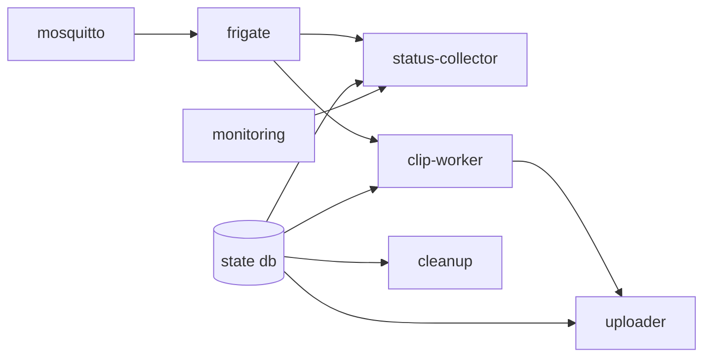

# LLD 07 — installer and host profiles

**Implements:** [INV-11](../invariants.md), PRD §3 and §15
**Status:** 📐 draft

> **Implementation status (2026-10-20).** §4 (host detection) and §5 (profiles, §5.1 `shm_size`)
> are built in `src/cctv/host.py`, with `cctv-host` as the CLI and `install.sh` running it in the
> image before starting anything. Detection degrades to `unknown` rather than guessing, and an
> unsupported host exits 78 before a pull. **§6 (the interview)** is built as `cctv-init`: it
> prompts for location, timezone, cameras and optional B2 credentials, validates the generated
> `cameras.yml` through the real loader before replacing it, writes `.env` at `0600`, redacts
> credentials from everything it prints, and supports `--non-interactive`, `--force`, `--print`
> and a live B2 credential test (`--no-test` to skip). **§7 (cloud provisioning)** is built as
> `cctv-provision` (`./scripts/provision.sh`): create the bucket, enable versioning, merge our
> expiry rule by rule *ID* so nobody else's rule is touched, read it back, then write, verify and
> delete a 1 KB probe object. `install.sh` runs it after the interview and before starting; a
> failure is loud but not fatal, because local recording does not need the bucket.
> `uninstall.sh --remove-lifecycle` removes our rule and keeps the others. §8's start order is
> built; §8.2's per-component verification is `cctv-doctor`. **Not built yet:** test
> the installer's half of the signed-bundle paths (M6.19–M6.24): the bundle itself is built,
> verified and signed by `src/cctv/release.py` and the `bundle` job in `publish.yml`, but
> `install.sh` does not yet consume `versions.yml`. §6.2 is built as `cctv-notify test`
> (`src/cctv/notify.py`): `install.sh` runs it after the stack is up, sends a real message to
> every configured channel, and reports each verdict without failing the install. ntfy is
> always a channel — it ships in the default stack — and Telegram is the optional second one.
> The profile table is data in `PROFILES`, so adding a row needs no code change.

Making a new machine into a working CCTV installation with one command, on hardware
we have never seen, without the operator needing to understand the internals.

---

## 1. The problem

The PRD's target is `git clone && ./install.sh`. That is easy to write for one known
machine and hard to write for the machines actually in play: an x86 mini-PC with an
Intel iGPU, a Raspberry Pi 5 with no accelerator, an ARM Mac used for development,
and Windows via Docker Desktop. Each needs different images, different Frigate
detector configuration, and different hardware-acceleration arguments.

The design response is **detect, propose, confirm** — never guess silently, never
require the operator to know what an OpenVINO device is.

---

## 2. Support matrix

| Host | Status | Detection signal | Profile |
|---|---|---|---|
| Linux x86_64, Intel iGPU | **Primary** | `/dev/dri` + Intel PCI vendor | `intel-igpu` |
| Linux x86_64, Coral USB | Supported | USB VID `18d1:9302` (or `1a6e:089a` pre-flash) | `coral-usb` |
| Linux x86_64, Coral M.2 | Supported | `/dev/apex_0` | `coral-pcie` |
| Linux x86_64, Hailo-8/8L | Supported | `/dev/hailo0` or `hailo` CLI | `hailo` |
| Linux x86_64, no accelerator | Supported | neither of the above | `cpu-x86` |
| Raspberry Pi 4 / 5 (arm64) | Supported, capacity-limited | `/proc/device-tree/model` contains `Raspberry Pi` | `pi-cpu` |
| Rockchip (RK3588 etc.) | Best effort | `/proc/device-tree/compatible` contains `rockchip` | `rknn` |
| Linux x86_64, Nvidia GPU | Best effort | `nvidia-smi` present | `nvidia` |
| macOS Apple Silicon | **Development only** | `uname` = `Darwin`, `arm64` | `dev-mac` |
| Windows + Docker Desktop | Best effort (WSL2) | `docker info` shows a `wsl` OSType | `wsl2` |
| Anything else | Refused | — | — |

The installer **states which row it matched**, in plain language, and asks for
confirmation. An unsupported platform is refused with an explanation, not attempted
until it fails halfway.

---

## 3. `install.sh` structure

```text
install.sh
│
├── lib/                     sourced helpers: log, ask, confirm, detect, docker, fs
├── scripts/detect-host.sh   pure detection → JSON on stdout
├── scripts/generate-config.py
└── scripts/doctor.sh        also runnable standalone
```

The installer is POSIX-ish bash (no `bash`-4-only features) so it runs on macOS's
system bash 3.2 and on Debian's `dash` if invoked that way — because a developer on a
Mac should not have to install bash 5 to test a change to the installer.

### 3.1 Ten phases

```text
┌──────────────────────────────────────────────────────────────────────┐
│ 1. PREFLIGHT     docker, compose v2, permissions, OS, arch, bash     │
│ 2. PROFILE       detect → propose → confirm → write config/host.yml  │
│ 3. STORAGE       DATA_DIR exists, writable, single fs, enough space  │
│ 4. INTERVIEW     location, timezone, cameras, B2, notifications      │
│ 5. VALIDATE      full config validation (fatal) + capacity (warn)    │
│ 6. GENERATE      frigate config, service configs, monitors, .env     │
│ 7. PROVISION     B2 bucket, credentials check, lifecycle rule        │
│ 8. PULL          images by pinned digest; verify digests             │
│ 9. START         compose up -d; wait for dependencies in order       │
│10. VERIFY        per-component health, one camera, one end-to-end    │
│                  clip; then print URLs and a diagnostics bundle      │
└──────────────────────────────────────────────────────────────────────┘
```

**Fatal vs warn is an explicit decision at each step.** Config invalid, disk
unwritable, credentials rejected: fatal, stop. Disk smaller than projected, no
accelerator detected, NTP not synchronised: warn, continue, and say so in the final
report. An installer that stops for a cosmetic problem is as annoying as one that
continues past a fatal one.

---

## 4. Host detection

`scripts/detect-host.sh` prints a single JSON object and nothing else, so it is
testable and reusable:

```json
{
  "os": "linux",
  "distro": "debian-12",
  "arch": "aarch64",
  "model": "Raspberry Pi 5 Model B Rev 1.0",
  "cpu_cores": 4,
  "memory_bytes": 8589934592,
  "docker": {"present": true, "version": "27.1.1", "compose": "v2.29.1", "ostype": "linux"},
  "gpu": {"dri_present": true, "intel": false, "nvidia": false, "vaapi_profiles": []},
  "accelerators": [
    {"type": "coral", "bus": "usb", "device": "18d1:9302"},
    {"type": "hailo", "device": "/dev/hailo0"}
  ],
  "recommended_profile": "coral-usb",
  "warnings": ["no hardware video decoder detected"],
  "unsupported_reason": null
}
```

### 4.1 Detection methods

| Field | Method | Fallback |
|---|---|---|
| `arch` | `uname -m`, normalised (`aarch64`→`arm64`, `x86_64`→`amd64`) | — |
| `model` | `/proc/device-tree/model` | `/sys/firmware/devicetree/base/model` |
| `os` | `uname -s` | — |
| `distro` | `/etc/os-release` | — |
| Nvidia | `command -v nvidia-smi` | — |
| Intel GPU | `/dev/dri` exists and `lspci` shows vendor `8086` | `/dev/dri/renderD128` exists |
| VAAPI | `vainfo` if present | Assume VAAPI supported if `/dev/dri` exists **and** warn |
| Coral USB | `lsusb` for `18d1:9302` / `1a6e:089a` | Scan `/sys/bus/usb/devices/*/idVendor` |
| Coral PCIe | `/dev/apex_0` exists | — |
| Hailo | `/dev/hailo0` exists or `command -v hailo` | — |
| WSL2 | `docker info` `OSType` contains `wsl`, or `/proc/version` contains `microsoft` | — |
| Apple Silicon | `uname` = `Darwin` and `sysctl -n machdep.cpu.brand_string` contains `Apple` | — |

**Detection must degrade to `unknown`, never to a wrong answer.** If `vainfo` is
absent we do not claim VAAPI works; we say we could not confirm it and pick a
conservative profile. A wrong acceleration profile produces a system that looks
configured and silently falls back to CPU detection — a slow, hot Pi that the
operator has no reason to suspect.

### 4.2 The confirmation prompt

```text
════════════════════════════════════════════════════════════════════
 Detected host
════════════════════════════════════════════════════════════════════
  Machine        Raspberry Pi 5 Model B Rev 1.0
  Architecture   arm64
  Memory         8.0 GiB
  Docker         27.1.1, compose v2.29.1
  Accelerator    none detected
  Video decode   hardware decoder available (/dev/dri)

  ⚠  No Coral Edge TPU or Hailo accelerator was found.
     Object detection will run on the CPU.
     With 4 cameras this will likely be too slow to be useful.

  Recommended profile:  pi-cpu
    · detection limited to 2 cameras at 640×360
    · detection framerate reduced to 3 fps
    · continuous recording: 2 days locally (≈43 GB per camera at 2 Mbps)

  Alternatives:
    1  pi-cpu                (recommended for this machine)
    2  pi-cpu-max            (more cameras; will be slow and hot)
    3  coral-usb             (I will attach a Coral Edge TPU)
    4  override manually

  Choose [1]:
════════════════════════════════════════════════════════════════════
```

The warning about CPU detection on a Pi is not decoration. It is the difference
between an operator who knows their system will be limited and one who concludes the
software is broken.

---

## 5. Host profiles

Stored in `config/host.yml` (generated, with a header), consumed by the config
generator and by compose profile selection.

| Profile | Detector | hwaccel | Camera guidance | Compose profiles |
|---|---|---|---|---|
| `intel-igpu` | `openvino` on `GPU` | `preset-vaapi` | up to 8 @ 1280×720 | `hwaccel-intel` |
| `coral-usb` | `edgetpu` `usb` | `preset-vaapi` if Intel | up to 12 | `hwaccel-coral` |
| `coral-pcie` | `edgetpu` `pci` | `preset-vaapi` if Intel | up to 16 | `hwaccel-coral` |
| `hailo` | `hailo8l` / `hailo8` | `preset-vaapi` if Intel | up to 16 | `hwaccel-hailo` |
| `cpu-x86` | `openvino` on `CPU` | none | up to 4 @ 640×360 | — |
| `pi-cpu` | `cpu` (`num_threads: 2`) | Pi hardware decode if available | **2** @ 640×360, 3 fps | — |
| `rknn` | `rknn` | Rockchip | up to 6 | `hwaccel-rknn` |
| `nvidia` | `onnx` / `tensorrt` | `preset-nvidia-h264` | up to 12 | `hwaccel-nvidia` |
| `dev-mac` | `zmq` → apple-silicon-detector | none | 1–2, synthetic source | `dev-synthetic` |
| `wsl2` | `cpu` or `openvino` on `CPU` | none | 2 @ 640×360 | — |

Profile application:

| Profile field | Effect on generated config |
|---|---|
| `detector` | Frigate `detectors:` block |
| `hwaccel` | Frigate `ffmpeg.hwaccel_args` |
| `shm_size` | Compose `shm_size` (Frigate uses shared memory for frame buffers) |
| `camera_limits` | Validation caps and warnings |
| `detect_defaults` | Default `detect.width`/`height`/`fps` per camera |
| `compose_profiles` | Which compose profiles are enabled |

**Override with a recorded reason.** An operator can force a profile; the override
and the reason are written to `system_events` so that a later "why is this machine
configured like this?" has an answer.

### 5.1 `shm_size`

Frigate relies on shared memory for frame passing, and the default Docker
`/dev/shm` of 64 MB is far too small — this is the single most common Frigate
deployment problem. The profile sets it from camera count and resolution:

```text
shm_mb = clamp(64 + 32 × cameras × (width × height) / (1280 × 720), 128, 1024)
```

The installer detects the actual `/dev/shm` size and warns if it cannot be honoured.

---

## 6. The interview

```text
LOCATION          parents-home            (validated: kebab-case, part of cloud keys)
TIMEZONE          Australia/Sydney        (validated against tzdata; defaulted from host, confirmed)
DATA_DIR          /opt/cctv               (default; validated)

CAMERAS           guided loop:
                    name        front-door
                    main RTSP   rtsp://…
                    sub RTSP    rtsp://… (optional)
                    detect?     yes
                    objects     person
                  → validated immediately, so mistakes surface now
                  → credentials are written to .env, referenced by ${VAR} in cameras.yml

CLOUD             enable B2 backup?       yes | no  (no → SKIPPED_BY_POLICY mode)
                  bucket            cctv-parents-home
                  key id / app key  (hidden input)
                  → tested live: reachable? writable? correct bucket?

NOTIFICATIONS     ntfy    topic + server URL
                  telegram bot token + chat id
                  → both send a test message during install
```

### 6.1 Principles

| Principle | Reason |
|---|---|
| Validate as you go | Discovering a bad RTSP URL at step 10 means redoing step 4 |
| Never echo secrets | Camera passwords and B2 keys use hidden input and are never printed back |
| Offer defaults everywhere | The common path should be pressing Enter |
| Test credentials live | A B2 key that fails at 3 a.m. is a support ticket; one that fails during install is a typo |
| Non-interactive mode | `--yes --config config/cameras.yml --env .env` for automation and CI |
| Never require a camera to finish | A camera feed that is not yet reachable should not block installation; the operator can add it later |

### 6.2 Test notifications during install

The installer sends a real message to ntfy and Telegram. A misconfigured
notification channel discovered during an incident is worthless; discovered during
installation, it is a five-second fix.

> **Built (2026-10-21)** as `cctv-notify test`, run by `install.sh` after the stack is up and
> before it prints the summary. Four decisions worth recording:
>
> - **It runs after `docker compose up`, not during the interview.** ntfy is a container, and a
>   test message sent while it is not running would report a failure that is not one.
> - **The topic is `CCTV_STATUS_NTFY_TOPIC`**, the same setting `status` generates Gatus's
>   config from. One topic, so a test message arrives where the real alerts will.
> - **"Not configured" is not "failed".** A site with ntfy only is a supported state and is
>   reported as skipped, not broken; a site with *half* a Telegram configuration exits 78,
>   because that is a mistake rather than a choice (the same distinction the uploader makes
>   between `DISABLED` and 78).
> - **A credential never reaches the output.** A Telegram bot token lives in the URL *path*, so
>   scrubbing userinfo — which is what `logging.redact_url` does, correctly, for camera URLs —
>   would not touch it. Errors are built from status codes and Telegram's own `description`,
>   and the token is substituted out as a last resort (INV-2).
>
> `doctor` gained the reachability half in its `connectivity` section: `GET /v1/health` on the
> ntfy server, `WARN` when it fails because alerts cannot be delivered but recording, clips,
> uploads and retention are all unaffected (INV-6: partial capability reported as partial).

---

## 7. Cloud provisioning

```text
1. Verify the credentials can list the bucket
2. Create the bucket if absent (private), with a clear message
3. Verify bucket versioning configuration; set it so deletes take effect
     → See cloud-object-layout §5.3: a bucket that keeps all versions means
       "deleted" objects are only hidden and remain billed
4. Merge our lifecycle rule into the existing rules, matched by prefix
     → Never clobber rules belonging to another tool
5. Read the rules back and assert ours is present with the expected values
6. Write a 1 KB probe object, read it back, verify its checksum, delete it,
   and confirm the deletion took effect
7. Report the outcome per step
```

Step 6 is the one that catches the problems that otherwise surface days later: a
bucket that is read-only, a region mismatch, a key scoped too narrowly, or versioning
that turns deletes into hides. All of them are caught at install time in under a
second, and all of them are far more expensive to diagnose later.

Step 5's read-back is equally important: writing a lifecycle rule and assuming it
applied is how a retention policy silently does not exist.

---

## 8. Start order and verification

### 8.1 Dependency order



Enforced with compose `depends_on` **health conditions**, not bare `depends_on`
(which only waits for a container to exist, not to be ready). Frigate reports healthy
via its API; our services report via `/health`.

### 8.2 Verification phase

```text
[1/7] Frigate API reachable and version matches ……………………………… ✓ 4.1s
[2/7] MQTT broker accepting connections ………………………………………… ✓ 0.3s
[3/7] clip-worker healthy, sweep watermark initialised ………………… ✓ 2.1s
[4/7] uploader healthy, storage credentials accepted …………………… ✓ 1.4s
[5/7] cleanup healthy, retention policy loaded …………………………… ✓ 0.7s
[6/7] status-collector healthy ………………………………………………………………… ✓ 1.1s
[7/7] Cameras online …………………………………………………………………………………… 2/3

      front-door   ✓ online, detection 5.0 fps
      garage       ✓ online, detection 5.0 fps
      backyard     ✗ offline — camera did not respond to RTSP

      The stack is running. backyard is not reachable; check the RTSP URL
      and credentials, then run ./update.sh --regenerate-config
```

| Rule | Reason |
|---|---|
| Time-boxed per step | An installer that hangs is worse than one that fails |
| Camera failure is not fatal | The system works without one camera, and forcing a fix mid-install helps nobody |
| Exit code reflects the worst outcome | `0` all good, `1` degraded but usable, `2` fatal |
| A diagnostics bundle is written | `logs/install-<ts>.tar.gz` with detection JSON, redacted config, container statuses, and logs. Turns "it didn't work" into a supportable report |

### 8.3 End-to-end verification (optional, `--verify-clips`)

If at least one camera is online, the installer can wait up to 5 minutes for one
complete event → clip → upload cycle, proving the whole pipeline rather than each
component in isolation. Off by default because it adds minutes to an install; offered
at the end with the time cost stated.

---

## 9. Idempotency and re-runs

```text
./install.sh                  on a configured machine → "already installed",
                              offers: [r]econfigure, [v]erify, [u]pgrade, [q]uit
./install.sh --yes            non-interactive, uses existing config
./install.sh --force          re-runs everything, keeping existing data
./install.sh --regenerate     regenerates config from cameras.yml, restarts
```

| Guarantee | Mechanism |
|---|---|
| Never deletes data | The installer has no delete path for `data/` |
| Never clobbers `.env` | Existing `.env` is preserved; changes are shown as a diff and confirmed |
| Never clobbers `cameras.yml` | Treated as operator-owned |
| Never overwrites hand-edited generated files | Per the config model's drift protection |
| Safe to interrupt | Each phase is independently re-runnable; there is no half-applied state |

---

## 10. `doctor.sh`

> **Implementation status (2026-10-20).** Built as `cctv-doctor` (`./scripts/doctor.sh`), run
> through the `doctor` ops-profile service: every table row except **containers** and the
> installed-image comparison in **versions** is checked, and those two report `skip` with the
> reason rather than passing. JSON is written to `data/logs/doctor-<ts>.json`, redacted through
> `logging.redact_url`.

The single command to run when something is wrong. Runnable at any time, read-only.

| Section | Checks |
|---|---|
| Host | Profile, `/dev/shm`, kernel, NTP synchronisation, clock skew |
| Docker | Version, compose version, daemon reachable, disk driver |
| Storage | `DATA_DIR` writable, single filesystem, free space, projection |
| Config | Validation with the full rule set; drift of generated files |
| Connectivity | Frigate API, MQTT, B2, notification endpoint, DNS |
| Database | Integrity, migrations current, row counts, WAL size |
| Pipeline | Last clip per camera, oldest pending, `FAILED_PERMANENT`, overdue retention |
| Containers | Per-container state, restart counts, health |
| Versions | Service versions vs `versions.yml`; Frigate API version |

Output is a human-readable report **and** `logs/doctor-<ts>.json`, with all secrets
redacted. The redaction is tested, because a diagnostics bundle that leaks a B2 key
into a forum post is a worse outcome than the original problem.

---

## 11. `uninstall.sh`

> **Implementation status (2026-10-20).** Built with `--images`, `--purge` and `--dry-run`.
> `--purge` types the location name, refuses a resolved data directory that is `/`, `$HOME`,
> `/data` or another system path, and never touches the bucket. `--remove-lifecycle` is
> accepted and reports honestly that this build creates no lifecycle rule. 12 tests run the
> script against a throwaway installation with a stub `docker`.

```text
./uninstall.sh                stop and remove containers; KEEP all data and config
./uninstall.sh --images       also remove images
./uninstall.sh --purge        also remove config/ and data/  — requires typing the location name
./uninstall.sh --remove-lifecycle   also remove the B2 lifecycle rule
```

| Default | Reason |
|---|---|
| Keep everything | The destructive option should never be the default, and `docker compose down` must not risk footage |
| `--purge` requires typing the location name | A `--yes` flag is too easy to add to a script. Typing `parents-home` is not |
| Lifecycle rules are kept by default | Removing them would strand objects in the bucket with no expiry and no explanation |
| A summary is printed of what was left behind | So the operator knows the data still exists and where |

---

## 12. Platform-specific notes

| Platform | Notes the installer prints |
|---|---|
| Raspberry Pi | Expect CPU detection limits; recommend a Coral or Hailo; warm about SD-card wear and recommend USB/NVMe storage for `DATA_DIR`; verify adequate power supply |
| WSL2 | Docker Desktop with the WSL2 backend is required (not Hyper-V); USB device passthrough for a Coral is unreliable and is not supported; `DATA_DIR` must live in the Linux filesystem, **not** under `/mnt/c` (filesystem semantics and performance are both unacceptable) |
| macOS | Development only. The Apple Silicon detector requires a separate client process; the RTSP source is typically synthetic. Explicitly not a deployment target |
| Nvidia | Requires the container toolkit; the installer checks for it and explains how to install it if absent |

---

## 13. Tests

| Test | Asserts |
|---|---|
| Detection JSON | Recorded `uname`/`/proc`/`lsusb` fixtures produce the expected profile |
| Unknown host | Detects nothing → conservative profile + explicit warning, not a guess |
| Detection degradation | Missing `vainfo` yields "unconfirmed", never a claim of VAAPI support |
| Refusal | An unsupported platform is refused with an explanation and a non-zero exit |
| Profiles | Each profile generates a config that Frigate's own validation accepts |
| shm sizing | The formula produces the expected size across camera counts and resolutions |
| Validation gate | An invalid config aborts before any container starts |
| **INV-11** | A corpus of invalid configs produces specific codes, fix strings, and exit 78 |
| Idempotent re-run | A second `install.sh` changes nothing and does not delete data |
| `.env` preservation | An existing `.env` is preserved and diffed, never clobbered |
| Live credential tests | A bad B2 key fails during install with an actionable message |
| Lifecycle merge | Pre-existing foreign lifecycle rules survive a re-install |
| Lifecycle read-back | A rule that fails to apply is detected and reported |
| Probe round-trip | The 1 KB probe verifies read *and* effective deletion (catches the hide trap) |
| Non-interactive | `--yes` completes with no prompts |
| Interruption | Ctrl-C during each phase leaves a re-runnable state and no data loss |
| Verification exit codes | All-healthy → 0; one camera offline → 1; fatal → 2 |
| Bundle redaction | The diagnostics bundle contains no credential values |
| Purge guard | `--purge` without the typed location name refuses |
| Uninstall | Default uninstall leaves `DATA_DIR` byte-identical |
